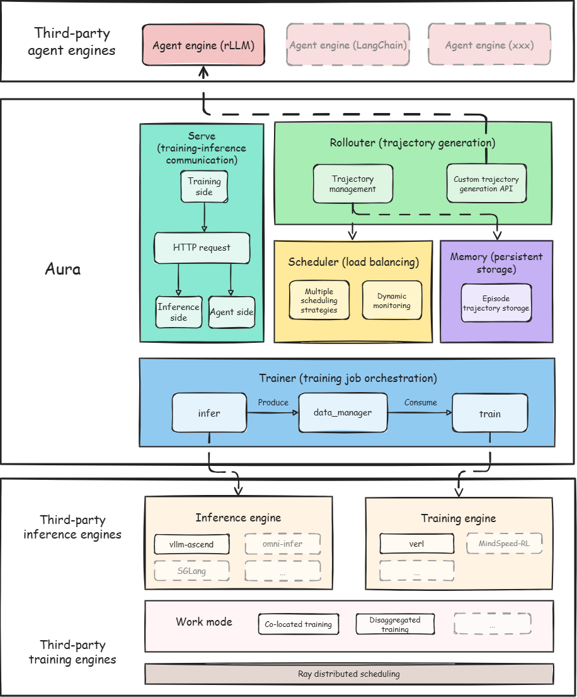

# Introduction

**Aura (Agentic Ultra-fast Reinforcement Architecture)** is an integrated training, inference, and tuning framework for agentic reinforcement learning that targets general-purpose models. Through unified training, inference, and optimization infrastructure, it aims to help LLMs further evolve from general language capabilities into intelligent agents capable of autonomous planning, tool calling, environment interaction, task execution, and long-horizon decision-making.
**Aura** is driven by task trajectories, environment feedback, and reward signals, and continuously uncovers and improves the reasoning and decision-making capabilities of foundation models in complex task scenarios through post-training techniques such as reinforcement learning. Models learn better policies through constant interaction with the environment, achieving a capability leap from a "generative model" to an "action-oriented agent".
**Aura** is compatible with multiple training engines, inference engines, and agent frameworks through unified abstract interfaces, and allows you to flexibly integrate custom models, task environments, and toolchains, reducing the engineering complexity of agent development and optimization. You can use Aura to quickly build intelligent agents for different service scenarios and continuously iterate model capabilities by combining domain data, feedback signals, and actual running results. In addition, Aura supports diverse reinforcement learning algorithms, reward mechanisms, and optimization strategies, provides flexible training and tuning capabilities for different types of tasks, and helps models continuously learn, adapt, and evolve in real environments.

**User Guide**

If you are using this software for the first time, you can start with the examples in [Quick Start](03_quick_start.md) and ensure that you prepare the required environment and software packages by following the steps described there.

If you are already familiar with the related processes, you can go directly to [Python API Reference](05_api_python.md) to obtain the function interfaces you need and accelerate your data processing.

# Software Architecture

**Figure 1** shows the software architecture of Aura.

**Figure 1 Aura software architecture**

**Table 1 Description of the architecture modules**

| Module                 | Description                                    |
|----------------------|---------------------------------------|
| **Third-party agent engines**     | Support multiple agent engines, including rLLM                    |
| **Serve (training-inference communication)**     | Support HTTP communication from the training side to the inference side and the agent side               |
| **Rollouter (trajectory generation)** | Handle agent trajectory generation, including trajectory management and custom trajectory generation APIs          |
| **Scheduler**        | Inference request scheduler that supports load balancing                        |
| **Memory**           | Persistent storage of trajectory data in the Episode format                 |
| **Trainer (training job orchestration)** | Training job management and orchestration, coordinating data flow between training and inference through `data_manager`. |
| **Inference engine**             | Support third-party inference engines, including vllm-ascend               |
| **Training engine**             | Support third-party training engines, including verl                      |
| **RAY distributed resource management**      | Ray-based distributed resource management that supports co-located and disaggregated deployment               |

# Supported Features

- [Co-located Training and Inference Usage Guide (On-Policy Strategy)](04_user_guide/02_hybrid.md): Training and inference run cooperatively on the same group of devices through time-division multiplexing.
- [One-Step Asynchronous Disaggregation of Training and Inference (One Step Off Strategy)](04_user_guide/03_one_step_off.md): Training and inference run in parallel on different nodes, with a one-round gap between training and inference in asynchronous training.
- [Fully Asynchronous Disaggregation of Training and Inference (Fully Async Strategy)](04_user_guide/04_fully_async.md): Full decoupling of training and inference based on one-step asynchronous disaggregation, with an N-round gap between training and inference in asynchronous training.
- [Mixed Batch Scheduling](04_user_guide/05_mixed_batch.md): Training and inference run in parallel on different nodes based on one-step asynchronous disaggregation, with an N-round gap between training and inference in asynchronous training.
- [Custom Agent Integration Guide](04_user_guide/06_custom_agent.md): Integrate custom agents into the Aura training framework.
