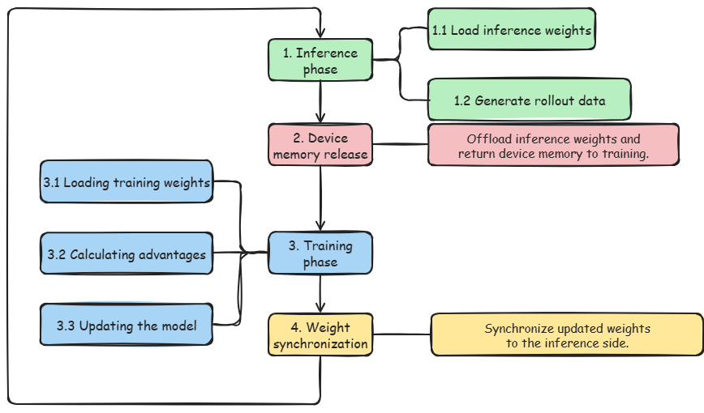

# Co-located Training and Inference Usage Guide (On-Policy Strategy)

## Introduction

Co-located training and inference (hybrid mode) is a resource deployment mode provided by Agent SDK that allows training and inference tasks to run cooperatively on the same group of NPUs or GPUs. Through a device memory time-division multiplexing mechanism, this mode allows training and inference to alternately use the device memory resources of the same group of devices, making it suitable for small and medium-scale clusters or resource-constrained scenarios.

Co-located mode is inherently an On-Policy training strategy: inference uses the latest policy to generate data, training immediately consumes this data to update the policy, and the next round of inference then uses the updated policy to generate new data. The entire process, "generate → train → generate", forms a tight loop within the same policy version, with no policy lag.

### Modes and Strategies

Co-located training and inference in Agent SDK uses a two-layer design:

- Deployment mode: the resource deployment method for training and inference. Currently, both co-located and disaggregated training and inference are supported.
- Training strategy: in co-located mode, the synchronization strategy for how training uses the data generated by inference. Co-located mode inherently adopts the On-Policy strategy: inference uses the latest policy to generate data, training immediately consumes this data to update the policy, and the next round of inference then uses the updated policy to generate new data. The entire process, "generate → train → generate", forms a tight loop within the same policy version, with no policy lag.

Therefore, when you set `work_mode` to `hybrid` in the configuration file, you select both the co-located deployment mode and the On-Policy synchronous training strategy.

### Runtime Process

In co-located mode, training and inference run alternately in each iteration:



- After the inference phase completes, the system automatically releases the device memory used by inference for training.
- After the training phase completes, the system automatically synchronizes the updated weights to the inference engine.
- The system manages the entire process automatically, with no manual intervention required.

### Applicable Scenarios

- The number of devices in the cluster is limited. Therefore, you cannot deploy separate training and inference clusters.
- You want to reduce cross-node communication and data movement overhead.
- You want inference to directly reuse the model weights already loaded by training, avoiding repeated loading.

> [!NOTE]
> If the cluster has sufficient resources and you want training and inference to run in parallel to improve throughput, see the [Disaggregated Training and Inference Usage Guide](03_one_step_off.md). Disaggregated mode uses the Off-Policy strategy (One Step Off), in which training uses the trajectory data generated by the policy of the previous round.

## Usage

### Step 1: Modifying `hosts.conf`

File path: `configs/hosts.conf`

Co-located mode supports single-server and multi-server deployment. The key point is that training and inference on each node share the same group of devices.

For **single-server co-located deployment**, you only need to configure one line and set both `train_master_index` and `infer_master_index` to 1:

```shell
# host,index,train_master_index,infer_master_index(optional)
<node IP address>,0,1,1
```

| Parameter | Description |
|------|------|
| `host` | Node IP address |
| `index` | Node index, starting from 0 |
| `train_master_index` | Training master node flag. Setting it to 1 indicates that this node starts training |
| `infer_master_index` | Inference master node flag. Setting it to 1 indicates that this node starts inference. **Co-located mode requires this parameter, and its value must be the same as that of `train_master_index`** |

> [!NOTE]
> The key indicator of co-located mode is that `train_master_index` and `infer_master_index` point to the same node. The system uses this to determine that the node is of the "hybrid" type and starts training and inference on the same node at the same time.

### Step 2: Modifying `base.conf`

File path: `configs/base.conf`

```shell
# Set the working mode to hybrid (co-located On-Policy training)
work_mode=hybrid

# Co-located mode requires a training YAML file
train_config_name=verl_train_hybrid_A3_t16_qwen3_4b_math_fsdp

# infer_config_name does not take effect in co-located mode and does not need to be configured
# infer_config_name=vllm_infer_i16_qwen3_32b
```

| Parameter | Description |
|------|------|
| `work_mode` | Setting it to `hybrid` indicates co-located deployment mode (On-Policy strategy) |
| `train_config_name` | Name of the training YAML configuration file (without the `.yaml` suffix) |
| `infer_config_name` | Name of the inference YAML configuration file. **This configuration does not take effect in co-located mode** |

### Step 3: Modifying the Training YAML Configuration File

The following example uses the verl backend and the Qwen3-4B model. The training configuration file path is `configs/train/verl_train_hybrid_A3_t16_qwen3_4b_math_fsdp.yaml`.

Modify the following parameters based on your actual environment:

#### 3.1 Path Parameters That Must Be Modified

| Parameter                                                  | Description                                                           | Example                                               |
|-----------------------------------------------------|--------------------------------------------------------------|--------------------------------------------------|
| `hydra.searchpath`                                  | Path of the verl configuration template. Change it to the absolute path of the `configs/train/verl_conf` directory in the aura code repository on your machine | `file:///home/work/aura/configs/train/verl_conf` |
| `verl_conf.data.train_files`                        | Path of the training dataset in the parquet format                                          | `/data/train.parquet`                            |
| `verl_conf.data.val_files`                          | Path of the validation dataset in the parquet format                                          | `/data/test.parquet`                             |
| `verl_conf.actor_rollout_ref.model.path`            | Path of the model weights                                                       | `/data/weights/qwen3-4b`                         |
| `train_instances.rollout_config.llm_tokenizer_path` | Path of the tokenizer (the same as the model path)                                               | `/data/weights/qwen3-4b`                         |

#### 3.2 Key Configuration Items in Co-located Mode

The following configuration items are the core parameters of co-located mode, and you must ensure that they are configured correctly. The example uses the Qwen3-4B model. Adjust the actual parameters based on the model specifications:

**`work_mode` in `train_instances` must be `hybrid`:**

```yaml
train_instances:
  - name: RL-QWEN3-4B-WITH-MATH
    executor_kwargs:
      work_mode: hybrid    # Must be set to hybrid
      train_engine: verl
```

**`use_on_policy` in `rollout_config` must be `true`:**

```yaml
train_instances:
  - name: RL-QWEN3-4B-WITH-MATH
    executor_kwargs:
      rollout_config:
        use_on_policy: true    # Must be set to true in co-located mode to ensure the On-Policy strategy
```

> [!NOTE]
> `use_on_policy` controls whether training uses the trajectory data generated by the latest policy. In co-located mode, you must set it to `true` to ensure that training uses the data produced by the current round of inference, that is, the On-Policy strategy.

**`hybrid_engine` configuration:**

```yaml
verl_conf:
  actor_rollout_ref:
    hybrid_engine: True    # Must be enabled in co-located mode
```

**Training parallelism configuration:**

```yaml
verl_conf:
  actor_rollout_ref:
    rollout:
      tensor_model_parallel_size: 4    # Training tensor parallelism size
      data_parallel_size: 2            # Training data parallelism size
  trainer:
    n_gpus_per_node: 16               # Number of devices per node
    nnodes: 1                         # Number of nodes
```

**Inference engine configuration (`infer_instances`):**

In co-located mode, the training process manages the inference engine internally. Therefore, `infer_instances` only needs parallelism parameters:

```yaml
infer_instances:
  - name: Qwen3-4B
    executor_kwargs:
      engine: vllm_proxy
      engine_kwargs:
        chat_server: "http://0.0.0.0:8080"   # The default value is sufficient. The startup script modifies it automatically
        model_name: Qwen3-4B
        tensor_parallel_size: 4               # Inference tensor parallelism size
        data_parallel_size: 2                 # Inference data parallelism size
```

**Agent loop manager configuration:**

Co-located mode requires you to specify `HybridAgentLoopManager`. This class manages the interaction loop between the agent and the inference engine in co-located mode, including scheduling inference requests, collecting trajectory data, and coordinating device memory switching between training and inference:

```yaml
verl_conf:
  actor_rollout_ref:
    rollout:
      agent:
        agent_loop_manager_class: aura.trainer.train_adapter.verl.hybrid.agent_loop_manager.HybridAgentLoopManager
```

#### 3.3 Device Resource Allocation

In co-located mode, training and inference share the same group of devices and alternately use device memory through a time-division multiplexing mechanism, with no manual allocation required. The total number of devices on a node is determined by `verl_conf.trainer.n_gpus_per_node` × `verl_conf.trainer.nnodes`.

**Training parallelism** is determined by the following parameters:

| Parallelism Dimension | Parameter Location | Description |
|---------|---------|------|
| Tensor parallelism (TP) | `verl_conf.actor_rollout_ref.rollout.tensor_model_parallel_size` | Tensor parallelism size during training |
| Data parallelism (DP) | `verl_conf.actor_rollout_ref.rollout.data_parallel_size` | Data parallelism size during training |

**Inference parallelism** is determined by the following parameters:

| Parallelism Dimension | Parameter Location | Description |
|---------|---------|------|
| Tensor parallelism (TP) | `infer_instances.executor_kwargs.engine_kwargs.tensor_parallel_size` | Tensor parallelism size during inference |
| Data parallelism (DP) | `infer_instances.executor_kwargs.engine_kwargs.data_parallel_size` | Number of inference workers |

> [!NOTE]
> In co-located mode, training and inference use the same group of devices and run alternately: during inference, this group of devices performs inference, and after inference completes, device memory is released. During training, this group of devices performs training updates. Therefore, the number of devices required for training and the number of devices required for inference must be the same, and both must equal the total number of devices on the node. For example, on a single server with 16 devices, training uses TP=4/DP=4 (16 devices), inference uses TP=4/DP=4 (16 devices), and both share the same group of 16 devices.

### Step 4: Starting Training

```bash
cd /home/work/AgentSDK/aura
bash scripts/start_rl_with_verl_vllm.sh
```

After startup, the system automatically identifies the node as the hybrid type and starts the training and inference processes in parallel on the same node.

## Source Code Implementation Principles

The core source code call chain of co-located mode is as follows:

### Startup Process

1. **Entry script** [start_rl_with_verl_vllm.sh](../../../../aura/scripts/start_rl_with_verl_vllm.sh): `get_node_type()` determines that the node is of the `hybrid` type based on `MASTER_TRAIN_INDEX` and `MASTER_INFER_INDEX` and starts the training and inference processes on the same node.
2. **Training cluster startup** [start_verl_train_cluster.sh](../../../../aura/scripts/train/start_verl_train_cluster.sh): Starts the Ray cluster and calls `aura/start.py` to submit the training task.
3. **Task routing** [train_register.py](../../../../aura/aura/trainer/trainer_register/train_register.py): Registers and routes to `verl_hybrid_train` based on `train_engine=verl` and `work_mode=hybrid`.

### Core Training Chain

| Component | Source Code Location | Description |
|------|---------|------|
| Task entry | [hybrid/train_main.py](../../../../aura/aura/trainer/train_adapter/verl/hybrid/train_main.py) | `HybridTaskRunner` initializes the resource pool and workers and calls `run_ppo()` |
| Trainer | [hybrid/ray_trainer.py](../../../../aura/aura/trainer/train_adapter/verl/hybrid/ray_trainer.py) | `HybridTrainer` inherits from the `RayPPOTrainer` of verl and manages the alternate execution of training and inference |
| Agent loop | [hybrid/agent_loop_manager.py](../../../../aura/aura/trainer/train_adapter/verl/hybrid/agent_loop_manager.py) | `HybridAgentLoopManager` manages the rollout loop in co-located mode and coordinates inference requests and result collection |

### Core Inference Chain

| Component | Source Code Location | Description |
|------|---------|------|
| Inference service management | [async_server.py](../../../../aura/aura/runner/infer_adapter/async_server.py) | `AsyncServerProxyManager` manages inference engine instances in co-located mode and supports `wake_up`/`sleep` device memory switching |
| Weight synchronization | [rollout_weight_manager.py](../../../../aura/aura/controllers/rollout_controller/rollout_weight_manager.py) | `RolloutWeightManager` synchronizes updated training weights to the inference engine |

### Device Memory Time-Division Multiplexing Mechanism

In co-located mode, training and inference alternately use device memory through the `wake_up` / `sleep` mechanism:

- Before the inference phase starts, the system calls `wake_up()` to load the inference weights into device memory.
- After the inference phase ends, the system calls `sleep()` to unload the inference weights and release device memory for training.
- The training phase uses the released device memory for model updates.
- After training completes, the system synchronizes the new weights to the inference engine through `update_weights()`.

## FAQs

### Q1: How Do I Verify That the System Correctly Identifies Co-located Mode

The startup log prints the following information:

```text
[INFO] NODE_TYPE: hybrid
[INFO] work_mode: hybrid
```

If it shows `train` or `infer`, check whether `train_master_index` and `infer_master_index` in `hosts.conf` both point to the same node.
