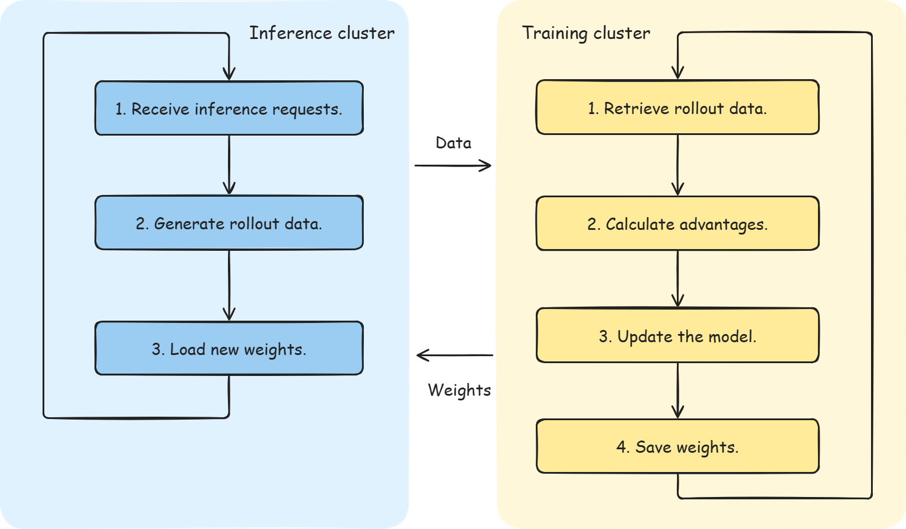

# One-Step Asynchronous Disaggregation of Training and Inference Usage Guide (One Step Off Strategy)

## Introduction

Disaggregation of training and inference is a resource deployment mode provided by Agent SDK. Training and inference tasks are deployed on different nodes and run independently in parallel. In this mode, the training cluster and the inference cluster interact asynchronously through weight files and rollout data. This mode suits large-scale clusters or scenarios that require high training throughput.

### Modes and Strategies

Disaggregation of training and inference in Agent SDK uses a two-layer design:

- Deployment mode: the resource deployment method for training and inference. Currently, both disaggregated and co-located training and inference are supported.
- Training strategy: the asynchronous strategy for how training uses the data generated by inference in disaggregation mode. Currently, only the One Step Off strategy is supported, in which training always uses the trajectory data produced by the previous round of inference and maintains a lag of one iteration step.

Therefore, when you set `work_mode` to `one_step_off` in the configuration file, you select both the disaggregated deployment mode and the One Step Off asynchronous training strategy.

### Running Process

In disaggregation mode, training and inference run in parallel on different nodes:



- The inference cluster continuously receives inference requests and generates rollout data.
- The training cluster obtains rollout data from the data queue, computes advantages, and updates the model.
- After training completes, the system saves the new weights to shared storage, and the inference cluster loads them automatically.

### Applicable Scenarios

- The cluster has sufficient NPUs, and you can deploy training and inference clusters separately.
- You want training and inference to run in parallel to maximize hardware utilization.
- The inference request volume is large, and you need a separate inference cluster to provide stable services.

> [!NOTE]
> If cluster resources are limited and you want training and inference to share the same group of NPUs, see the [Co-located Training and Inference Usage Guide](02_hybrid.md).

### Differences from Co-located Mode

| Feature | Co-located Mode (Hybrid) | Disaggregation Mode (One Step Off) |
|------|-------------------|--------------------|
| Deployment method | Training and inference run on the same group of NPUs | Training and inference run on different nodes |
| Execution method | Training and inference alternate serially | Training and inference run in parallel |
| Device memory usage | Time-division multiplexing, and inference releases device memory for training after it completes | Each occupies device memory independently |
| Weight synchronization | Weights are synchronized directly to the inference engine after training | Weights are synchronized asynchronously through weight files |
| Applicable scale | Small and medium-sized clusters | Large-scale clusters |
| Throughput | Affected by long-tail inference | Higher throughput because training and inference run in parallel |

## Usage

### Step 1: Modifying `hosts.conf`

File path: `configs/hosts.conf`

In disaggregation mode, inference nodes come first and training nodes come after, and you **do not configure `infer_master_index`**:

**Two-node disaggregated deployment** (one inference node and one training node):

```shell
# host,index,train_master_index,infer_master_index(optional)
<node IP address 1>,0,0
<node IP address 2>,1,1
```

| Parameter | Description |
|------|------|
| `host` | Node IP address |
| `index` | Node index, starting from 0. **The index of an inference node must be smaller than the index of a training node.** |
| `train_master_index` | Training master node flag. Set it to 1 to indicate that the node starts training. **Configure this parameter only on training nodes.** |
| `infer_master_index` | Inference master node flag. **Do not configure this parameter in disaggregation mode.** |

> [!NOTE]
> The key indicator of disaggregation mode is that you **do not configure `infer_master_index`**. The system determines a node as an inference node when `VC_TASK_INDEX < MASTER_TRAIN_INDEX` and as a training node when `VC_TASK_INDEX >= MASTER_TRAIN_INDEX`. Inference nodes must come before training nodes. For details about the node type determination logic, see [start_rl_with_verl_vllm.sh](../../../../aura/scripts/start_rl_with_verl_vllm.sh). For details about parameter parsing, see [utils.sh](../../../../aura/scripts/base/utils.sh).

### Step 2: Modifying `base.conf`

File path: `configs/base.conf`

```shell
# Set the working mode to one_step_off
work_mode=one_step_off

# Training YAML file
train_config_name=verl_train_async_A3_t16_qwen3_8b_math_fsdp

# Inference YAML file (mandatory in disaggregation mode)
infer_config_name=vllm_infer_i16_qwen3_8b
```

| Parameter | Description |
|------|-----------------------------------------|
| `work_mode` | Setting it to `one_step_off` indicates one-step asynchronous disaggregation mode. |
| `train_config_name` | Training YAML configuration file name (without the `.yaml` suffix). |
| `infer_config_name` | Inference YAML configuration file name (without the `.yaml` suffix). **You must configure this parameter in disaggregation mode.** |

### Step 3: Modifying the Training YAML Configuration File

The following example uses the verl backend and the Qwen3-8B model. The training configuration file path is `configs/train/verl_train_async_A3_t16_qwen3_8b_math_fsdp.yaml`.

Modify the following parameters based on your actual environment:

#### 3.1 Path Parameters That You Must Modify

| Parameter | Description | Example |
|-----------------------------------------------------|--------------------------------------------------------------|--------------------------------------------------|
| `hydra.searchpath` | Path of the verl configuration template. Change it to the absolute path of the `configs/train/verl_conf` directory in the aura code repository on your machine. | `file:///home/work/aura/configs/train/verl_conf` |
| `verl_conf.extras.data_loader.train_data_path` | Training dataset path (in the bin/idx format, without the file suffix). | `/data/train/rl` |
| `verl_conf.actor_rollout_ref.model.path` | Model weight path. | `/data/weights/qwen3-8b` |
| `train_instances.rollout_config.llm_tokenizer_path` | Tokenizer path (the same as the model path). | `/data/weights/qwen3-8b` |

#### 3.2 Key Configuration Items for One-Step Asynchronous Disaggregation Mode (One Step Off Strategy)

The following configuration items are the core parameters that ensure the correct operation of disaggregated deployment and the One Step Off strategy. The example uses the Qwen3-8B model. Adjust the parameters based on the actual model specifications.

**`work_mode` in `train_instances` must be `one_step_off`:**

```yaml
train_instances:
  - name: RL-QWEN3-8B-WITH-MATH
    executor_kwargs:
      work_mode: one_step_off    # Must be set to one_step_off
      train_engine: verl
```

**`use_on_policy` in `rollout_config` must be `false`:**

```yaml
train_instances:
  - name: RL-QWEN3-8B-WITH-MATH
    executor_kwargs:
      rollout_config:
        use_on_policy: false    # Must be set to false in disaggregation mode to ensure the Off-Policy strategy
```

> [!NOTE]
> `use_on_policy` controls whether training uses the trajectory data generated by the current latest policy. In disaggregation mode, you must set it to `false` to ensure that training uses the trajectory data produced by the policy of the previous round, that is, the One Step Off strategy.

**`hybrid_engine` must be disabled:**

```yaml
verl_conf:
  actor_rollout_ref:
    hybrid_engine: False    # Must be disabled in disaggregation mode
```

**Training parallelism configuration:**

```yaml
verl_conf:
  actor_rollout_ref:
    rollout:
      tensor_model_parallel_size: 8    # Training tensor parallelism size
      data_parallel_size: 2            # Training data parallelism size
  trainer:
    n_gpus_per_node: 16               # Number of NPUs per node
    nnodes: 1                         # Number of training nodes
```

**Inference engine configuration (`infer_instances`):**

In disaggregation mode, you do not need to configure the following parameters in `infer_instances` manually. The startup script obtains them from the inference cluster and replaces them automatically. For details about the replacement logic, see [start_verl_train_cluster.sh](../../../../aura/scripts/train/start_verl_train_cluster.sh).

- `chat_server`: Inference service address (assembled by the startup script from the IP address of the inference master node).
- `prefill_server_list`: List of Prefill instance addresses (calculated automatically by the startup script from the IP addresses of the inference nodes).
- `decode_server_list`: List of Decode instance addresses (calculated automatically by the startup script from the IP addresses of the inference nodes).
- `tensor_parallel_size`: Inference tensor parallelism size (from the inference YAML).
- `data_parallel_size`: Inference data parallelism size (from the inference YAML).
- `enable_expert_parallel`: Whether to enable expert parallelism (from the inference YAML).

> [!NOTE]
> This automatic replacement mechanism relies on a **shared file system**. The inference cluster writes the configuration to a temporary file in shared storage. The training master node reads the file and uses `sed` to replace the training YAML. Other training nodes read the modified configuration through the shared file system. Only the training master node performs the replacement, which avoids modification conflicts caused by concurrent operations on multiple nodes.

Fill in the default values during configuration:

```yaml
infer_instances:
  - name: Qwen3-8B
    executor_kwargs:
      engine: vllm_proxy
      engine_kwargs:
        chat_server: "http://0.0.0.0:8080"           # Use the default value. The startup script modifies it automatically
        prefill_server_list: ["http://0.0.0.0:20012"]  # Use the default value. The startup script modifies it automatically
        decode_server_list: []
        model_name: Qwen3-8B
        tensor_parallel_size: 8
        data_parallel_size: 2
        enable_expert_parallel: false
```

### Step 4: Modifying the Inference YAML Configuration File

Disaggregation mode requires a separate inference YAML file. The path is `configs/infer/vllm_infer_i16_qwen3_8b.yaml`.

#### 4.1 Path Parameters That You Must Modify

| Parameter | Description | Example |
|------|------|------|
| `infer_model_path` | Model weight path. | `/data/weights/qwen3-8b` |

#### 4.2 Key Inference Configuration Items

```yaml
# Model name
infer_model_name: Qwen3-8B

# Inference parallelism
tensor_parallel_size: 8
data_parallel_size: 2

# Maximum model output length
max_model_len: 32768

# Ratio of device memory occupied by inference
gpu_memory_utilization: 0.6
```

| Parameter | Description |
|------|------|
| `tensor_parallel_size` | Inference tensor parallelism size. |
| `data_parallel_size` | Inference data parallelism size. |
| `max_model_len` | Maximum model output length. |
| `gpu_memory_utilization` | Ratio of device memory occupied by inference. |

#### 4.3 NPU Resource Allocation

In disaggregation mode, the training cluster and the inference cluster occupy NPU resources exclusively and do not interfere with each other:

- **NPUs in the training cluster** = `n_gpus_per_node` × `nnodes` (number of training nodes)
- **NPUs in the inference cluster** = `tensor_parallel_size` × `data_parallel_size`

The startup script automatically calculates the node allocation of the inference cluster based on the parallelism parameters in the inference YAML. Each inference instance requires `tensor_parallel_size × data_parallel_size` NPUs, and the number of required nodes is the NPU count divided by the number of NPUs per node.

For example, if `tensor_parallel_size=8` and `data_parallel_size=2`, inference requires 16 NPUs, which means one node on an Atlas 900 A3 SuperPoD supernode (16 × 64 GB).

### Step 5: Starting Training

```bash
cd /home/work/AgentSDK/aura
bash scripts/start_rl_with_verl_vllm.sh
```

After startup, the system automatically identifies the role of each node based on `hosts.conf`:

- Inference nodes start the vLLM inference cluster.
- Training nodes wait for the inference cluster to become ready and then start the training process.

## Source Code Implementation

The core source code call chain of disaggregation mode is as follows:

### Startup Process

1. **Entry script** [start_rl_with_verl_vllm.sh](../../../../aura/scripts/start_rl_with_verl_vllm.sh): `get_node_type()` determines whether a node is of the `infer` or `train` type based on `VC_TASK_INDEX` and `MASTER_TRAIN_INDEX`, and starts the inference and training processes accordingly.
2. **Inference cluster startup** [start_vllm_infer_cluster.sh](../../../../aura/scripts/infer/start_vllm_infer_cluster.sh): parses the inference configuration, starts the vLLM inference service, and writes the service address to shared storage.
3. **Inference configuration parsing** [parse_infer_config.sh](../../../../aura/scripts/infer/vllm/parse_infer_config.sh): reads the parallelism parameters from the inference YAML, automatically allocates node IP addresses, and writes them to a temporary file in `conf_for_train/`.
4. **Training cluster startup** [start_verl_train_cluster.sh](../../../../aura/scripts/train/start_verl_train_cluster.sh): waits for the inference cluster to become ready, reads the temporary file to replace the inference configuration in the training YAML, and starts training.
5. **Task routing** [train_register.py](../../../../aura/aura/trainer/trainer_register/train_register.py): registers and routes to `verl_async_train` based on `train_engine=verl` and `work_mode=one_step_off`.

### Core Training Chain

| Component | Source Code Location | Description |
|------|---------|------|
| Task entry | [full_async/train_main.py](../../../../aura/aura/trainer/train_adapter/verl/full_async/train_main.py) | `FullyAsyncTaskRunner` initializes the training components and starts rollout and training asynchronously. |
| Trainer | [full_async/full_async_trainer.py](../../../../aura/aura/trainer/train_adapter/verl/full_async/full_async_trainer.py) | `FullyAsyncTrainer` inherits `SeparateRayPPOTrainer` from verl and manages the asynchronous training loop and weight synchronization. |
| Training controller | [train_controller.py](../../../../aura/aura/controllers/train_controller/train_controller.py) | `TrainController` manages training data distribution, rollout scheduling, and weight version control. |
| Data management | [data_manager.py](../../../../aura/aura/data_manager/data_manager.py) | `DataManager` manages the loading and distribution of training data. |

### Core Inference Chain

| Component | Source Code Location | Description |
|------|---------|------|
| Rollout service | [rollout_service.py](../../../../aura/aura/trainer/rollout/rollout_service.py) | `start_rollout()` starts the rollout process and interacts with the inference cluster to generate rollout data. |
| Inference service management | [async_server.py](../../../../aura/aura/runner/infer_adapter/async_server.py) | `AsyncServerManager` manages inference engine instances in disaggregation mode. |
| Weight synchronization | [rollout_weight_manager.py](../../../../aura/aura/controllers/rollout_controller/rollout_weight_manager.py) | `RolloutWeightManager` handles the asynchronous synchronization of training weights to the inference engine. |

### Automatic Configuration Replacement Mechanism

In disaggregation mode, the startup script automatically replaces the inference configuration in the training YAML. The process is as follows:

1. When the inference cluster starts, [write_infer_server_list()](../../../../aura/scripts/infer/vllm/parse_infer_config.sh) and [write_infer_parallel_size()](../../../../aura/scripts/infer/vllm/parse_infer_config.sh) write the service addresses and parallelism sizes to a temporary file in shared storage.
2. When the training cluster starts, [get_infer_server_config()](../../../../aura/scripts/train/start_verl_train_cluster.sh) reads the temporary file.
3. [replace_infer_server_config()](../../../../aura/scripts/train/start_verl_train_cluster.sh) uses `sed` to replace `chat_server`, `prefill_server_list`, `decode_server_list`, `tensor_parallel_size`, `data_parallel_size`, and `enable_expert_parallel` in the training YAML (only the training master node performs the replacement, which relies on the shared file system).

## FAQs

### Q1: What Should I Do If the Inference Cluster Fails to Start in Disaggregation Mode

Check the following items:

1. Whether `infer_model_path` in the inference YAML correctly points to the model weight path.
2. Whether the number of NPUs on the inference node meets the requirement of `tensor_parallel_size × data_parallel_size`.
3. Whether the inference node can access shared storage (the weight file path).

### Q2: How Do I Confirm That the System Correctly Identifies Disaggregation Mode

The startup log prints the following information:

```text
[INFO] NODE_TYPE: infer    # Inference node
[INFO] NODE_TYPE: train    # Training node
[INFO] work_mode: one_step_off
```

If the node type is displayed incorrectly, check whether `hosts.conf` and `base.conf` are configured correctly.

### Q3: What Should I Do If the Training Cluster Times Out While Waiting for the Inference Cluster to Become Ready

In disaggregation mode, the training cluster waits for the inference cluster to finish starting before it starts training. If the inference cluster starts slowly, the training log continuously prints the following:

```text
[WARN] external vllm cluster is not ready, waiting 5 seconds...
```

This is normal. The process continues automatically after the inference cluster becomes ready. If the inference cluster does not become ready for a long time, check the startup log of the inference cluster.
