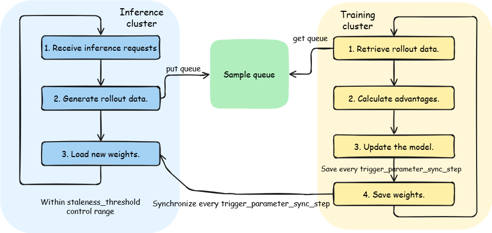

# Fully Asynchronous Disaggregation of Training and Inference Usage Guide (Fully Async Strategy)

## Introduction

Fully asynchronous training and inference is a resource deployment mode provided by Agent SDK. It is a further evolution of the single-step asynchronous disaggregation of training and inference mode. Through complete decoupling of rollout and the trainer, streaming data transmission, multi-step asynchronous weight synchronization, and freshness control, it overlaps rollout generation with trainer training, which significantly alleviates the NPU idle problem caused by long-tail samples and improves overall training throughput.

### Modes and Strategies

Disaggregation of training and inference in Agent SDK uses a two-layer design:

- Deployment mode: the resource deployment method for training and inference. Currently, disaggregated and co-located training and inference are supported.
- Training strategy: the asynchronous strategy for how training uses the data generated by inference in disaggregation mode. Currently, two strategies are supported:
  - **One Step Off strategy**: training always uses the trajectory data produced by the inference of the previous round and maintains a lag of one iteration step.
  - **Fully Async strategy**: training and inference are fully decoupled and run in parallel. The inference side streams trajectories at the granularity of a prompt group, and the training side consumes them asynchronously. Through freshness (staleness) control and multi-step weight version synchronization, the mode achieves continuous training with no iteration-step lag.

Therefore, when you set `work_mode` to `fully_async` in the configuration file, you select both the disaggregated deployment mode for training and inference and the Fully Async strategy.

### Running Process

In disaggregation mode, training and inference run in parallel on different nodes:



- The inference cluster continuously receives inference requests, generates rollout trajectory data, and **streams it into the sample queue** at the granularity of a **prompt group**. The number generated and the queue backlog are controlled by the `staleness_threshold` and `require_batches` parameters. When either limit is exceeded, backpressure is applied automatically (generation pauses and new weights are synchronized during this time).
- The training cluster pulls samples from the sample queue asynchronously, computes advantages, and updates the model. It publishes new weights every `trigger_parameter_sync_step` steps.
- After the new weights are saved to shared storage, the inference cluster automatically **detects and loads** the new weight version to complete synchronization, and resets the staleness counter to the number of in-flight samples.

### Applicable Scenarios

- The cluster has sufficient NPUs, and you can deploy training and inference clusters separately.
- You want training and inference to run in parallel to maximize hardware utilization.
- The inference request volume is large, and you need a separate inference cluster to provide stable services.
- The data has a pronounced long tail (some trajectories take much longer to generate than the average), and you need the training and inference times to overlap to hide the long-tail wait.

> [!NOTE]
> If cluster resources are limited and you want training and inference to share the same group of NPUs, see the [Co-located Training and Inference Usage Guide](02_hybrid.md). If you want training and inference to run in parallel but keep a one-iteration-step lag, see the [Single-Step Asynchronous Disaggregation of Training and Inference Usage Guide (One Step Off Strategy)](03_one_step_off.md).

### Differences from Single-Step Asynchronous Disaggregation Mode

| Feature | Single-Step Asynchronous Disaggregation Mode (One Step Off) | Fully Asynchronous Disaggregation Mode (Fully Async)    |
|------|------------------------|-------------------------|
| Deployment method | Training and inference run on different nodes | Training and inference run on different nodes |
| Execution method | Training and inference run in parallel but keep a one-iteration-step lag | Training and inference run fully decoupled and in parallel, with no iteration-step lag |
| Data exchange | At the batch level (`DataManager` accumulates batches and transmits them) | At the sample level with streaming (`SampleQueue` writes back group by group) |
| Weight synchronization | Weights are synchronized directly to the inference engine after training | Multi-version asynchronous synchronization through shared storage, with the inference side actively detecting and loading weights |
| Data freshness control | None (inherently has a one-iteration-step lag) | Controlled through the staleness metric and the backpressure mechanism |
| Applicable scale | Large-scale clusters | Large-scale clusters with pronounced long-tail scenarios |
| Throughput | Higher because training and inference run in parallel | Even higher because training and inference times overlap |

## Working Principles

### Streaming Trajectory Generation and Backpressure Control

- **Streaming write-back**: the inference side generates trajectories for the prompts in a batch concurrently. Once the n trajectories of a prompt are complete, it immediately formats them and writes them to the `SampleQueue` together with the weight version number, without waiting for the other prompts in the same batch to finish. Because the prompt group is the smallest delivery unit, this shortens the wait for the first packet on the training side.
- **Backpressure control**: the inference side increments the freshness counter (staleness) each time it delivers a prompt group. When either the freshness counter or the queue backlog reaches the `max_required_samples` limit, the inference side pauses generation and waits. During the wait, it polls the weight version and loads new weights when it finds a new version. Generation resumes after the backlog falls.
- **Freshness-preserving fallback**: when the `SampleQueue` is full, it discards the oldest sample at the head of the queue (the one with the lowest weight version) and appends the new sample, which ensures that inference-side production is not blocked.

### Asynchronous Training Consumption and Iteration Control

- **Asynchronous pulling**: the training side takes samples one by one from the `SampleQueue` according to the batch count set by `require_batches` and blocks while the queue is empty. After it obtains `ppo_mini_batch_size × require_batches` samples, it merges them, aligns them, and updates the parameters. It advances one training iteration for each batch consumed.
- **Iteration step control**: the training side maintains a local training step counter and increments it for each local step advanced. When the counter reaches `trigger_parameter_sync_step`, it increments the weight version number and resets the counter, then writes the new weights to shared storage and publishes the new version to the inference side.
- **Staleness observation**: the training side collects statistics on the weight version distribution and the stale proportion of the current batch (the number of outdated samples relative to the latest version) to quantify the off-policy degree for observation and parameter tuning.

### Weight Version Synchronization and Staleness Management

- **Publish-detect model**: the training side writes weights to shared storage (the `iter_<N>` directory) at the cadence of `trigger_parameter_sync_step` and notifies the inference side. Through `RolloutWeightManager`, the inference side maintains three states: the predicted highest version, the converted version, and the loaded version. It actively detects new versions before each generation. The training side does not push weights directly.
- **Synchronization trigger conditions**: the inference side triggers loading only when staleness reaches `max_required_samples` and shared storage contains a weight version higher than the locally loaded version. Otherwise, it skips loading to preserve the overlap of new and old data and to avoid frequent switching.
- **Staleness reset**: after loading new weights, the inference side resets staleness to the current number of in-flight (unconsumed) samples. In-flight old samples are not discarded or rewritten and continue to be consumed by the training side. Only samples generated afterwards are products of the latest weights.

### Key Parameters

| Parameter | Location | Description |
|------|------|------|
| `staleness_threshold` | `verl_conf.async_training` | Freshness threshold (0 to 1). Together with `require_batches` and `trigger_parameter_sync_step`, it determines `max_required_samples` |
| `trigger_parameter_sync_step` | `verl_conf.async_training` | Number of training iterations between weight publications, which also advances the weight version number |
| `require_batches` | `verl_conf.async_training` | Number of batches that the training side consumes from the `SampleQueue` at a time |
| `max_required_samples` | Calculated and injected automatically | `= ppo_mini_batch_size × require_batches × (1 + staleness_threshold) × trigger_parameter_sync_step`. It also serves as the `SampleQueue` capacity and the backpressure threshold |

## Usage

### Step 1: Modifying `hosts.conf`

File path: `configs/hosts.conf`

In disaggregation mode, inference nodes come first and training nodes come after, and you **do not configure `infer_master_index`**:

**Two-node disaggregated deployment** (one inference node and one training node):

```shell
# host,index,train_master_index,infer_master_index(optional)
<node IP address 1>,0,0
<node IP address 2>,1,1
```

| Parameter | Description |
|------|------|
| `host` | Node IP address |
| `index` | Node index, starting from 0. **The index of an inference node must be smaller than the index of a training node.** |
| `train_master_index` | Training master node flag. Set it to 1 to indicate that the node starts training. **Configure this parameter only on training nodes.** |
| `infer_master_index` | Inference master node flag. **Do not configure this parameter in disaggregation mode.** |

> [!NOTE]
> The key marker of disaggregation mode is that you **do not configure `infer_master_index`**. The system determines a node as an inference node when `VC_TASK_INDEX < MASTER_TRAIN_INDEX` and as a training node when `VC_TASK_INDEX >= MASTER_TRAIN_INDEX`. Inference nodes must come before training nodes. For details about the node type determination logic, see [start_rl_with_verl_vllm.sh](../../../../aura/scripts/start_rl_with_verl_vllm.sh). For details about parameter parsing, see [utils.sh](../../../../aura/scripts/base/utils.sh).

### Step 2: Modifying `base.conf`

File path: `configs/base.conf`

```shell
# Set the working mode to fully_async
work_mode=fully_async

# Training YAML file
train_config_name=verl_train_fully_async_A3_t16_qwen3_32b_math_fsdp

# Inference YAML file (mandatory in disaggregation mode)
infer_config_name=vllm_infer_i16_qwen3_32b
```

| Parameter | Description |
|------|------|
| `work_mode` | Set it to `fully_async` to enable the fully asynchronous disaggregation mode. |
| `train_config_name` | Training YAML configuration file name (without the `.yaml` suffix). |
| `infer_config_name` | Inference YAML configuration file name (without the `.yaml` suffix). **You must configure this parameter in disaggregation mode.** |

### Step 3: Modifying the Training YAML Configuration File

The following example uses the verl backend and the Qwen3-32B model. The training configuration file path is `configs/train/verl_train_fully_async_A3_t16_qwen3_32b_math_fsdp.yaml`.

Modify the following parameters based on your actual environment:

#### 3.1 Path Parameters That You Must Modify

| Parameter                                                  | Description                                                           | Example                                               |
|-----------------------------------------------------|--------------------------------------------------------------|--------------------------------------------------|
| `hydra.searchpath`                                  | Path of the verl configuration template. Change it to the absolute path of the `configs/train/verl_conf` directory in the aura code repository on your machine. | `file:///home/work/aura/configs/train/verl_conf` |
| `verl_conf.extras.data_loader.train_data_path`      | Training dataset path (in the bin/idx format, without the file suffix). | `/data/train/rl`                                 |
| `verl_conf.actor_rollout_ref.model.path`            | Model weight path. | `/data/weights/qwen3-32b`                        |
| `train_instances.rollout_config.llm_tokenizer_path` | Tokenizer path (the same as the model path). | `/data/weights/qwen3-32b`                        |

#### 3.2 Key Configuration Items for Fully Asynchronous Disaggregation Mode (Fully Async Strategy)

The following configuration items are the core parameters that ensure the correct operation of fully asynchronous deployment and strategy. The example uses the Qwen3-32B model. Adjust the parameters based on the actual model specifications.

**`work_mode` in `train_instances` must be `fully_async`:**

```yaml
train_instances:
  - name: RL-QWEN3-32B-WITH-MATH
    executor_kwargs:
      work_mode: fully_async    # Must be set to fully_async
      train_engine: verl
```

**`use_on_policy` in `rollout_config` must be `false`:**

```yaml
train_instances:
  - name: RL-QWEN3-32B-WITH-MATH
    executor_kwargs:
      rollout_config:
        use_on_policy: false    # Must be set to false in fully asynchronous mode to ensure the Off-Policy strategy
```

> [!NOTE]
> `use_on_policy` controls whether training uses the trajectory data generated by the current latest policy. In fully asynchronous mode, you must set it to `false`.

**`hybrid_engine` must be disabled:**

```yaml
verl_conf:
  actor_rollout_ref:
    hybrid_engine: False    # Must be disabled in disaggregation mode
```

**Training parallelism configuration:**

```yaml
verl_conf:
  actor_rollout_ref:
    rollout:
      tensor_model_parallel_size: 4    # Training tensor parallelism size
      data_parallel_size: 4            # Training data parallelism size
  trainer:
    n_gpus_per_node: 16               # Number of NPUs per node
    nnodes: 1                         # Number of training nodes
```

**Asynchronous training configuration (core parameters of fully asynchronous mode):**

```yaml
verl_conf:
  async_training:
    use_rollout_log_probs: True
    staleness_threshold: 0.5              # Freshness threshold
    trigger_parameter_sync_step: 4        # Number of iterations between weight synchronizations
    require_batches: 4                    # Number of batches consumed from the SampleQueue at a time
    partial_rollout: False
```

**Recommended asynchronous training configurations:**

| No. | `staleness_threshold` | `trigger_parameter_sync_step` | `require_batches` | Characteristics and Applicable Scenarios |
|------|------|------|------|------|
| 1 | 0.5 | 2 | 4 | **High-frequency synchronization + high freshness**: publishes weights every 2 iterations, has the lowest off-policy degree, and keeps data closest to the current policy. The synchronization overhead is higher, which suits scenarios that are sensitive to data freshness, where inference-side generation is stable and frequent weight synchronization is acceptable. |
| 2 | 0.75 | 2 | 4 | **High-frequency synchronization + lenient staleness tolerance**: maintains frequent synchronization while enlarging the buffer, which absorbs short-term generation fluctuations on the inference side. This configuration suits scenarios where the generation speed fluctuates slightly but the off-policy degree must stay low. |
| 3 | 0.5 | 4 | 4 | **Balanced (the configuration in the current example)**: the synchronization frequency and freshness are moderate, the buffer is larger, and backpressure is less likely to trigger. This configuration suits general large-scale scenarios where training and inference have relaxed pacing. |
| 4 | 0.75 | 4 | 4 | **Sparse synchronization + high staleness tolerance**: has the lowest synchronization overhead and the largest buffer, which maximizes the overlap between training and inference. This configuration suits scenarios with a pronounced long tail, large inference-side jitter, and low sensitivity to off-policy. |

**Directions for parameter tuning**:

- The larger `trigger_parameter_sync_step` is, the sparser weight synchronization becomes and the lower the synchronization overhead is. However, the gap between the weight versions of the training side and the inference side grows.
- The larger `staleness_threshold` is, the more stale samples are allowed, the larger the buffer (`max_required_samples`) is, and the harder backpressure is to trigger. However, the off-policy degree grows.
- Usually, fix `require_batches` (the training-side consumption pace) first, and then tune `trigger_parameter_sync_step` and `staleness_threshold` based on the trade-off between synchronization overhead and data freshness.

> [!NOTE]
> You do not need to configure `max_required_samples` manually. At startup, [fully_async/train_main.py](../../../../aura/aura/trainer/train_adapter/verl/fully_async/train_main.py) calculates it automatically (`= ppo_mini_batch_size × require_batches × (1 + staleness_threshold) × trigger_parameter_sync_step`) and injects it into the rollout configuration and the `SampleQueue` capacity. For the preceding example, the calculation result is 4 × 4 × 1.5 × 4 = 96.

**Inference engine configuration (`infer_instances`):**

In disaggregation mode, you do not need to configure the following parameters in `infer_instances` manually. The startup script obtains them from the inference cluster and replaces them automatically. For details about the replacement logic, see [start_verl_train_cluster.sh](../../../../aura/scripts/train/start_verl_train_cluster.sh).

- `chat_server`: Inference service address (assembled by the startup script from the IP address of the inference master node).
- `prefill_server_list`: List of Prefill instance addresses (automatically calculated by the startup script based on the inference node IP addresses).
- `decode_server_list`: List of Decode instance addresses (automatically calculated by the startup script based on the inference node IP addresses).
- `tensor_parallel_size`: Inference tensor parallelism size (from the inference YAML).
- `data_parallel_size`: Inference data parallelism size (from the inference YAML).
- `enable_expert_parallel`: Whether to enable expert parallelism (from the inference YAML).

> [!NOTE]
> This automatic replacement mechanism relies on a **shared file system**. The inference cluster writes the configuration to a temporary file in shared storage. The training master node reads the file and replaces the training YAML by using `sed`. Other training nodes read the modified configuration through the shared file system. Only the training master node performs the replacement, which avoids modification conflicts caused by concurrent operations on multiple nodes.

Fill in the default values during configuration:

```yaml
infer_instances:
  - name: Qwen3-32B
    executor_kwargs:
      engine: vllm_proxy
      engine_kwargs:
        chat_server: "http://0.0.0.0:8080"           # Use the default value. The startup script modifies it automatically
        prefill_server_list: ["http://0.0.0.0:20012"]  # Use the default value. The startup script modifies it automatically
        decode_server_list: []
        model_name: Qwen3-32B
        tensor_parallel_size: 4
        data_parallel_size: 4
        enable_expert_parallel: false
```

### Step 4: Modifying the Inference YAML Configuration File

Disaggregation mode requires a separate inference YAML file. The path is `configs/infer/vllm_infer_i16_qwen3_32b.yaml`.

#### 4.1 Path Parameters That You Must Modify

| Parameter | Description | Example |
|------|------|------|
| `infer_model_path` | Model weight path. | `/data/weights/qwen3-32b` |

#### 4.2 Key Inference Configuration Items

```yaml
# Model name
infer_model_name: Qwen3-32B

# Inference parallelism
tensor_parallel_size: 4
data_parallel_size: 4

# Maximum model output length
max_model_len: 32768

# Ratio of device memory occupied by inference
gpu_memory_utilization: 0.6
```

| Parameter | Description |
|------|------|
| `tensor_parallel_size` | Inference tensor parallelism size. |
| `data_parallel_size` | Inference data parallelism size. |
| `max_model_len` | Maximum model output length. |
| `gpu_memory_utilization` | Ratio of device memory occupied by inference. |

#### 4.3 NPU Resource Allocation

In disaggregation mode, the training cluster and the inference cluster occupy NPU resources exclusively and do not interfere with each other:

- **NPUs in the training cluster** = `n_gpus_per_node` × `nnodes` (number of training nodes)
- **NPUs in the inference cluster** = `tensor_parallel_size` × `data_parallel_size`

The startup script automatically calculates the node allocation of the inference cluster based on the parallelism parameters in the inference YAML. Each inference instance requires `tensor_parallel_size × data_parallel_size` NPUs, and the number of required nodes is the NPU count divided by the number of NPUs per node.

For example, if `tensor_parallel_size=4` and `data_parallel_size=4`, inference requires 16 NPUs, which means one node on an Atlas 900 A3 SuperPoD supernode (16 × 64 GB).

### Step 5: Starting Training

```bash
cd /home/work/AgentSDK/aura
bash scripts/start_rl_with_verl_vllm.sh
```

After startup, the system automatically identifies the role of each node based on `hosts.conf`:

- Inference nodes start the vLLM inference cluster.
- Training nodes wait for the inference cluster to become ready and then start the training process.

## Source Code Implementation Principles

The core source code call chain of fully asynchronous mode is as follows:

### Startup Process

1. **Entry script** [start_rl_with_verl_vllm.sh](../../../../aura/scripts/start_rl_with_verl_vllm.sh): `get_node_type()` determines whether a node is of the `infer` or `train` type based on `VC_TASK_INDEX` and `MASTER_TRAIN_INDEX`, and starts the inference and training processes accordingly.
2. **Inference cluster startup** [start_vllm_infer_cluster.sh](../../../../aura/scripts/infer/start_vllm_infer_cluster.sh): parses the inference configuration, starts the vLLM inference service, and writes the service address to shared storage.
3. **Inference configuration parsing** [parse_infer_config.sh](../../../../aura/scripts/infer/vllm/parse_infer_config.sh): reads the parallelism parameters from the inference YAML, automatically allocates node IP addresses, and writes them to a temporary file in `conf_for_train/`.
4. **Training cluster startup** [start_verl_train_cluster.sh](../../../../aura/scripts/train/start_verl_train_cluster.sh): waits for the inference cluster to become ready, reads the temporary file to replace the inference configuration in the training YAML, and starts training.
5. **Task routing** [train_register.py](../../../../aura/aura/trainer/trainer_register/train_register.py): registers and routes to `verl_fully_async_train` based on `train_engine=verl` and `work_mode=fully_async`.
6. **Fully asynchronous entry** [fully_async/train_main.py](../../../../aura/aura/trainer/train_adapter/verl/fully_async/train_main.py): calculates `required_samples`/`max_required_samples`, creates the `SampleQueue`, injects `max_required_samples` into the rollout configuration, and starts `start_fully_async_rollout` and training asynchronously.

### Core Training Chain

| Component | Source Code Location | Description |
|------|---------|------|
| Task entry | [fully_async/train_main.py](../../../../aura/aura/trainer/train_adapter/verl/fully_async/train_main.py) | `start_train`: calculates the sample lower and upper limits, creates the `SampleQueue`, and starts fully asynchronous rollout and training asynchronously. |
| Trainer | [full_async/full_async_trainer.py](../../../../aura/aura/trainer/train_adapter/verl/full_async/full_async_trainer.py) | `FullyAsyncTrainer` inherits `SeparateRayPPOTrainer` from verl and asynchronously consumes the `SampleQueue`, advances training iterations, and publishes weight versions by step count. |
| Sample queue | [sample_queue.py](../../../../aura/aura/controllers/rollout_controller/sample_queue.py) | `SampleQueue`: the inference side writes in a streaming manner, the training side pulls asynchronously, and the oldest sample is discarded when the capacity is full. |
| Training controller | [train_controller.py](../../../../aura/aura/controllers/train_controller/train_controller.py) | `TrainController` manages training data distribution, rollout scheduling, and weight version publishing. |
| Data management | [data_manager.py](../../../../aura/aura/data_manager/data_manager.py) | `DataManager` manages the loading and distribution of training data. |

### Core Inference Chain

| Component | Source Code Location | Description |
|------|---------|------|
| Rollout service | [rollout_service.py](../../../../aura/aura/trainer/rollout/rollout_service.py) | `start_fully_async_rollout` starts the fully asynchronous rollout process and injects the `SampleQueue` and `max_required_samples`. |
| Executor | [fully_async_rollout_executor.py](../../../../aura/aura/trainer/rollout/fully_async_rollout_executor.py) | `FullyAsyncRolloutExecutor` main loop: pops batches, merges them, injects them into the data manager, and triggers generation. |
| Work unit | [rollout_worker.py](../../../../aura/aura/trainer/rollout/rollout_worker.py) | Streaming trajectory generation, backpressure control, and weight version detection and loading. |
| Weight synchronization | [rollout_weight_manager.py](../../../../aura/aura/controllers/rollout_controller/rollout_weight_manager.py) | `RolloutWeightManager` weight version management and asynchronous synchronized update of training weights. |
| Inference service management | [async_server.py](../../../../aura/aura/runner/infer_adapter/async_server.py) | `AsyncServerManager` manages inference engine instances in disaggregation mode. |

### Automatic Configuration Replacement Mechanism

In disaggregation mode, the startup script automatically replaces the inference configuration in the training YAML. The process is as follows:

1. When the inference cluster starts, [write_infer_server_list()](../../../../aura/scripts/infer/vllm/parse_infer_config.sh) and [write_infer_parallel_size()](../../../../aura/scripts/infer/vllm/parse_infer_config.sh) write the service addresses and parallelism sizes to a temporary file in shared storage.
2. When the training cluster starts, [get_infer_server_config()](../../../../aura/scripts/train/start_verl_train_cluster.sh) reads the temporary file.
3. [replace_infer_server_config()](../../../../aura/scripts/train/start_verl_train_cluster.sh) uses `sed` to replace `chat_server`, `prefill_server_list`, `decode_server_list`, `tensor_parallel_size`, `data_parallel_size`, and `enable_expert_parallel` in the training YAML (only the training master node performs the replacement, which relies on the shared file system).

## FAQs

### Q1: What Should I Do If the Inference Cluster Fails to Start in Fully Asynchronous Mode

Check the following items:

1. Whether `infer_model_path` in the inference YAML correctly points to the model weight path.
2. Whether the number of NPUs on the inference node meets the requirement of `tensor_parallel_size × data_parallel_size`.
3. Whether the inference node can access shared storage (the weight file path).

### Q2: How Do I Confirm That the System Correctly Identifies Fully Asynchronous Mode

The startup log prints the following information:

```text
[INFO] NODE_TYPE: infer    # Inference node
[INFO] NODE_TYPE: train    # Training node
[INFO] work_mode: fully_async
```

If the node type is displayed incorrectly, check whether `hosts.conf` and `base.conf` are configured correctly.

### Q3: What Should I Do If the Training Cluster Times Out While Waiting for the Inference Cluster to Become Ready

In disaggregation mode, the training cluster waits for the inference cluster to finish starting before it starts training. If the inference cluster starts slowly, the training log continuously prints the following:

```text
[WARN] external vllm cluster is not ready, waiting 5 seconds...
```

This is normal. The process continues automatically after the inference cluster becomes ready. If the inference cluster does not become ready for a long time, check the startup log of the inference cluster.

### Q4: How Do I Confirm That Backpressure and Weight Synchronization Take Effect

The inference-side log prints the staleness and queue status. For example, when `max_required_samples` is 96 and backpressure is triggered, the following appears:

```text
[async-rollout] backpressure triggered: staleness=.../96, queue_size=.../96, current_weight_version=...
```

When weight synchronization occurs, the following appears:

```text
[async-rollout] weights reloaded: new_version=..., staleness_reset_to=...
```
