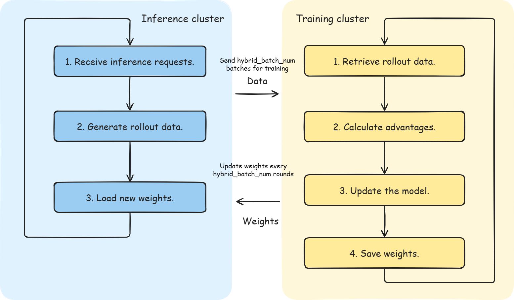
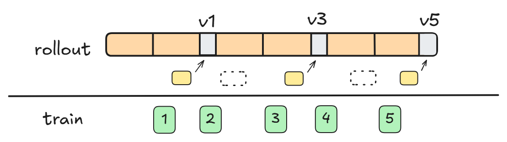

# Mixed Batch Scheduling Usage Guide<a name="ZH-CN_TOPIC_MIXED_BATCH_SCHEDULING_GUIDE"></a>

## Introduction

Mixed Batch Scheduling is a scheduling optimization strategy that Agent SDK provides in disaggregated training and inference mode. Building on the single-step asynchronous disaggregation mode, this strategy lets the inference side process multiple training batches consecutively after a single weight update and streams the inference results to the training side, which reduces the weight switching frequency. However, compared with the single-step asynchronous disaggregation mode, accuracy decreases slightly because the training and inference iterations differ by multiple steps.

**Core idea: one weight update, multiple training outputs.**

### Modes and Strategies

Mixed Batch Scheduling is a sub-strategy of disaggregation mode and inherits the two-layer design of that mode:

- Deployment mode: training and inference are deployed on different nodes and run in parallel.
- Training strategy: based on the One Step Off strategy, training uses the trajectory data produced by the policy of the previous round or earlier. Through batch merging (the inference side produces multiple batches consecutively after one weight update) and version control, Mixed Batch Scheduling ensures that weight versions correspond correctly to training data versions under off-policy.

When you set `work_mode` to `one_step_off` in the configuration file and also set `init_num_group_batches = 2`, `hybrid_batch_num = 2`, and `enable_version_control: true`, you select the Mixed Batch Scheduling optimization (with two batches as an example).

### Running Process

Mixed Batch Scheduling is a sub-strategy of disaggregation mode. Training and inference run in parallel on different nodes, and on that basis the batch processing on the inference side is optimized:



- At initialization on the training side, `initialize_rollout()` calls `send_initial_batch_groups_to_rollout()` to fill the inference queue with `init_num_group_batches` (2) prompts and establish the initial pipeline.
- At the start of each generation cycle, the inference side first synchronizes the latest weights to the inference engine according to version control (the first cycle uses the initial weights), and then **consecutively generates the data of `hybrid_batch_num` (2) batches** within one generation cycle: it still generates batch by batch at the granularity of a single batch (`global_batch_size` prompts), but **batches do not wait for weight synchronization** in between, until all batches in the current cycle are generated. The next weight synchronization occurs at the start of the next generation cycle.
- Each time the trajectory data of a sub-batch is collected, the inference side immediately sends the inference result to the training side, and the training side puts it into the training queue through `receive_minibatch()`→`put_minibatch_to_queue()`.
- After the training side receives a training batch, it starts training. After each round of training, it exports the weights as iter_0X.
- The weight conversion component on the training side verifies the version through `enable_version_control` (`required_version = max_possible_version - 1`). It converts the weight format and writes the result to drive (weights_0X) only when the version matches, and it automatically skips intermediate versions. The inference side is not aware of this conversion and only polls and loads the weights_0X of the latest version at the start of each generation cycle.

### Applicable Scenarios

- Disaggregated deployment, where the weight switching overhead is large (for example, slow network transmission or file I/O).
- You want to reduce the weight switching frequency on the inference side and improve NPU utilization.
- You have a high tolerance for off-policy deviation and allow the inference side to process multiple batches with the same weights.

> [!TIP]
> If cluster resources are limited and you want training and inference to share the same group of NPUs, see the [Co-located Training and Inference Usage Guide](02_hybrid.md).
> If you want to run the standard disaggregation mode (processing one batch per weight update), see the [Single-Step Asynchronous Disaggregation of Training and Inference Usage Guide](03_one_step_off.md) for details.
> If you need to increase training speed and reduce long tails, consider the [Fully Asynchronous Disaggregation of Training and Inference Usage Guide](04_fully_async.md).

### Differences from Other Modes

| Feature                | Co-located Mode (Hybrid) | Single-Step Asynchronous Disaggregation Mode (One Step Off) | Mixed Batch Scheduling |
|-------------------|--------------|------------------------|--------------------------------|
| Deployment method              | Training and inference run on the same group of NPUs  | Training and inference run on different nodes            | Training and inference run on different nodes                    |
| Execution method              | Training and inference alternate serially    | Training and inference run in parallel              | Training and inference run in parallel                      |
| Strategy type              | On-Policy    | Off-Policy             | Off-Policy                     |
| Batch count processed per weight update | 1            | 1                      | N (N=hybrid_batch_num)          |
| Weight switching frequency            | Every round           | Every round                     | Every N rounds                          |
| Version control              | No            | No                      | Yes (`enable_version_control`)      |
| Device memory usage              | Time-division multiplexing         | Each occupies device memory independently                 | Each occupies device memory independently                         |
| Applicable scale              | Small and medium-sized clusters       | Large-scale clusters                  | Large-scale clusters                          |

## Usage

### Step 1: Modifying `hosts.conf`

File path: `configs/hosts.conf`

Mixed Batch Scheduling is a sub-strategy of disaggregation mode. Therefore, the deployment method is the same as that of disaggregation mode: inference nodes come first, training nodes come after, and you **do not configure `infer_master_index`**.

**Two-node disaggregated deployment** (one inference node and one training node):

```shell
# host,index,train_master_index,infer_master_index(optional)
192.168.0.1,0,0
192.168.0.2,1,1
```

| Parameter                 | Description                                   |
|--------------------|--------------------------------------|
| `host`               | Node IP address.                             |
| `index`              | Node index, starting from 0. **The index of an inference node must be smaller than the index of a training node.**     |
| `train_master_index` | Training master node identifier. Set it to 1 to indicate that the node starts training. **Configure this parameter only on training nodes.** |
| `infer_master_index` | Inference master node identifier. **Do not configure this parameter in disaggregation mode.**              |

> [!IMPORTANT]
> The `hosts.conf` configuration for Mixed Batch Scheduling is exactly the same as that for disaggregation mode, and in both cases you do not configure `infer_master_index`. The system determines a node as an inference node when `VC_TASK_INDEX < MASTER_TRAIN_INDEX` and as a training node when `VC_TASK_INDEX >= MASTER_TRAIN_INDEX`. For details, see the [Single-Step Asynchronous Disaggregation of Training and Inference Usage Guide](03_one_step_off.md#step-1-modifying-hostsconf).

### Step 2: Modifying `base.conf`

File path: `configs/base.conf`

```shell
# Set the working mode to one_step_off (Mixed Batch Scheduling is a sub-strategy of disaggregation mode)
work_mode=one_step_off

# Training YAML file (use the mixed version)
train_config_name=verl_train_mixed_A3_t16_qwen36_27b_math_fsdp

# Inference YAML file (mandatory in disaggregation mode)
infer_config_name=vllm_infer_i16_qwen36_27b
```

| Parameter | Description |
|------|------|
| `work_mode` | Set it to `one_step_off` to enable disaggregation mode (Mixed Batch Scheduling is a sub-strategy of it). |
| `train_config_name` | Training YAML configuration file name. **Use the `mixed` version (without the .yaml suffix).** |
| `infer_config_name` | Inference YAML configuration file name (without the .yaml suffix). **You must configure this parameter in disaggregation mode.** |

### Step 3: Modifying the Training YAML Configuration File

The following example uses the verl backend and the Qwen3.6-27B model. The training configuration file path is `configs/train/verl_train_mixed_A3_t16_qwen36_27b_math_fsdp.yaml`.

Modify the following parameters based on your actual environment.

#### 3.1 Path Parameters That You Must Modify

| Parameter                                                  | Description                                                      | Example                                               |
|-----------------------------------------------------|---------------------------------------------------------|--------------------------------------------------|
| `hydra.searchpath`                                  | Path of the verl configuration template. Change it to the absolute path of the `configs/train/verl_conf` directory in the aura code repository. | `file:///home/work/aura/configs/train/verl_conf` |
| `verl_conf.extras.data_loader.train_data_path`      | Training dataset path (the bin/idx format, without the file suffix).                               | `/data/train/rl`                                 |
| `verl_conf.actor_rollout_ref.model.path`            | Model weight path.                                                  | `/data/weights/Qwen3.6-27B`                      |
| `train_instances.rollout_config.llm_tokenizer_path` | Tokenizer path (the same as the model path).                                          | `/data/weights/Qwen3.6-27B`                      |

#### 3.2 Key Configuration Items for Mixed Batch Scheduling

The following configuration items are the core parameters of Mixed Batch Scheduling, and they control batch merging and weight version verification. The example uses the Qwen3.6-27B model. Therefore, adjust them based on your model specifications.

**`work_mode` in `train_instances` must be `one_step_off`:**

```yaml
train_instances:
  - name: RL-QWEN36-27B-WITH-MATH
    executor_kwargs:
      work_mode: one_step_off    # Must be set to one_step_off
      train_engine: verl
```

**`use_on_policy` in `rollout_config` must be `false`:**

```yaml
train_instances:
  - name: RL-QWEN36-27B-WITH-MATH
    executor_kwargs:
      rollout_config:
        use_on_policy: false    # Mixed Batch Scheduling uses the Off-Policy strategy, so you must set it to false
```

> [!IMPORTANT]
> Mixed Batch Scheduling is based on the Off-Policy strategy. Therefore, you must set `use_on_policy` to `false`.

**Core parameters of Mixed Batch Scheduling:**

```yaml
verl_conf:
  extras:
    init_num_group_batches: 2    # Number of data batches loaded from the DataLoader for the first time. You must change it to 2 to enable Mixed Batch Scheduling

train_instances:
  - name: RL-QWEN36-27B-WITH-MATH
    executor_kwargs:
      rollout_config:
        hybrid_batch_num: 2              # Number of batches processed consecutively after one weight update
        enable_version_control: true     # Enable version control to skip weight updates of intermediate versions
```

| Parameter                       | Description                                                                        | Recommended Value                             |
|--------------------------|---------------------------------------------------------------------------|---------------------------------|
| `init_num_group_batches` | Number of prompts that the inference side loads for the first time.                                                          | 2                            |
| `hybrid_batch_num`       | Number of batches that the inference side processes consecutively after one weight update. The larger the value, the lower the weight switching frequency, but the greater the off-policy deviation.                       | 2, equal to `init_num_group_batches` |
| `enable_version_control` | After you enable version control, the inference side updates weights only when `required_version == max_possible_version - 1`, and it skips intermediate versions. | true                            |

> [!IMPORTANT]
> You must configure these three parameters in coordination. `hybrid_batch_num` determines the step size of weight switching, `init_num_group_batches` ensures that the inference side has enough data at the start, and `enable_version_control` ensures that the inference weight version is updated as expected under off-policy.

**`hybrid_engine` must be disabled:**

```yaml
verl_conf:
  actor_rollout_ref:
    hybrid_engine: False    # Must be disabled in disaggregation mode
```

**Training parallelism configuration:**

```yaml
verl_conf:
  actor_rollout_ref:
    rollout:
      tensor_model_parallel_size: 8    # Training tensor parallelism size
      data_parallel_size: 2            # Training data parallelism size
  trainer:
    n_gpus_per_node: 16               # Number of NPUs per node
    nnodes: 1                         # Number of training nodes
```

**Inference engine configuration (`infer_instances`):**

In disaggregation mode, you do not need to manually configure the following parameters in `infer_instances`. The startup script obtains and replaces them automatically from the inference cluster (for the replacement logic, see [start_verl_train_cluster.sh](../../../../aura/scripts/train/start_verl_train_cluster.sh)):

- `chat_server`: inference service address (concatenated by the startup script using the IP address of the inference master node)
- `prefill_server_list`: list of Prefill instance addresses (automatically calculated by the startup script based on inference node IP addresses)
- `decode_server_list`: list of Decode instance addresses (automatically calculated by the startup script based on inference node IP addresses)
- `tensor_parallel_size`: inference tensor parallelism size (from the inference YAML)
- `data_parallel_size`: inference data parallelism size (from the inference YAML)
- `enable_expert_parallel`: whether to enable expert parallelism (from the inference YAML)

> [!NOTE]
> This automatic replacement mechanism depends on a **shared file system**: the inference cluster writes the configuration to a temporary file in shared storage, the training master node reads it and replaces the training YAML through `sed`, and other training nodes read the modified configuration through the shared file system. Only the training master node performs the replacement, which avoids concurrent modification conflicts across multiple nodes.

Fill in the default values during configuration:

```yaml
infer_instances:
  - name: Qwen3.6-27B
    executor_kwargs:
      engine: vllm_proxy
      engine_kwargs:
        chat_server: "http://0.0.0.0:8080"           # The default value is fine. The startup script modifies it automatically
        prefill_server_list: ["http://0.0.0.0:20012"]  # The default value is fine. The startup script modifies it automatically
        decode_server_list: []
        model_name: Qwen3.6-27B
        tensor_parallel_size: 4
        data_parallel_size: 4
        enable_expert_parallel: false
```

### Step 4: Modifying the Inference YAML Configuration File

Disaggregation mode requires a separate inference YAML file. The path is `configs/infer/vllm_infer_i16_qwen36_27b.yaml`.

#### 4.1 Path Parameters That You Must Modify

| Parameter                 | Description     | Example                          |
|--------------------|--------|-----------------------------|
| `infer_model_path` | Model weight path. | `/data/weights/Qwen3.6-27B` |

#### 4.2 Key Inference Configuration Items

```yaml
# Model name
infer_model_name: Qwen3.6-27B

# Inference parallelism
tensor_parallel_size: 4
data_parallel_size: 4

# Maximum model output length
max_model_len: 32768

# Ratio of device memory occupied by inference
gpu_memory_utilization: 0.6
```

| Parameter | Description |
|------|------|
| `tensor_parallel_size` | Inference tensor parallelism size. |
| `data_parallel_size` | Inference data parallelism size. |
| `max_model_len` | Maximum model output length. |
| `gpu_memory_utilization` | Ratio of device memory occupied by inference. |

#### 4.3 NPU Resource Allocation

As in the single-step asynchronous disaggregation mode, the training cluster and the inference cluster each occupy NPU resources exclusively:

- **NPUs in the training cluster** = `n_gpus_per_node` × `nnodes` (number of training nodes)
- **NPUs in the inference cluster** = `tensor_parallel_size` × `data_parallel_size`

The startup script automatically calculates the node allocation of the inference cluster based on the parallelism parameters in the inference YAML. Each inference instance requires `tensor_parallel_size × data_parallel_size` NPUs, and the number of required nodes is the NPU count divided by the number of NPUs per node.

For example, if `tensor_parallel_size=4` and `data_parallel_size=4`, inference requires 16 NPUs, which means one node on an A3 machine (16 NPUs per node).

### Step 5: Starting Training

```bash
cd /home/work/AgentSDK/aura
bash scripts/start_rl_with_verl_vllm.sh
```

After startup, the system automatically identifies the role of each node based on `hosts.conf`:

- Inference nodes start the vLLM inference cluster.
- Training nodes wait for the inference cluster to become ready and then start the training process.

## Working Principles

### Mixed Batch Scheduling Execution Process

Taking `hybrid_batch_num=2` as an example, a complete Mixed Batch Scheduling cycle is as follows:

**1. Initialization phase:**

- The training side calls `initialize_rollout()`, which calls `send_initial_batch_groups_to_rollout()`, to fill the inference queue with `init_num_group_batches` (2) prompts.
- The inference side starts, and the training side finishes deployment and initialization and generates `init_num_group_batches` (2) batches of data at one time.

**2. Inference phase:**

- At the start of each generation cycle, the inference side first synchronizes the latest weights to the inference engine according to version control (the first cycle uses the initial weights), and then **consecutively generates the data of `hybrid_batch_num` (2) batches** within one generation cycle: it still generates batch by batch at the granularity of a single batch (`global_batch_size` prompts), but **batches do not wait for weight synchronization** in between, until all batches in the current cycle are generated. The next weight synchronization occurs at the start of the next generation cycle.
- Each time the trajectory data of a sub-batch is collected, the inference side immediately sends the inference result to the training side, and the training side puts it into the training queue through `receive_minibatch()`→`put_minibatch_to_queue()`.

**3. Training and weight update phase:**

- After the training side receives a training batch, it starts training. After each round of training, it exports the weights as iter_0X.
- The weight conversion component on the training side verifies the version through `enable_version_control`: `required_version = max_possible_version - 1`.
- Only when the version matches does the system convert the weight format and write the result to drive (weights_0X), and it automatically skips intermediate versions. The inference side is not aware of this conversion and only polls and loads the weights_0X of the latest version at the start of each generation cycle.

### Version Control Mechanism

Version control is the core of Mixed Batch Scheduling and ensures that weight versions correspond correctly to training data versions under off-policy:



| Concept                     | Description                                                                         |
|------------------------|----------------------------------------------------------------------------|
| `max_possible_version` | The initial value is 0. It increases by `hybrid_batch_num` at the start of each generation cycle on the inference side, and it represents the maximum version number covered by the current batch group.                      |
| `required_version`     | `max_possible_version - 1`, that is, the weight version that the inference side expects to receive.                                   |
| `input_weight_version` | The weight version exported after each round of training on the training side, that is, the input version that the weight conversion process receives this time.                                          |
| Version match                   | When `input_weight_version` == `required_version`, the system writes the training weights to drive (weights_0X) and updates the inference weights. |
| Version skip                   | When `input_weight_version` != `required_version`, the system skips this conversion and the inference side continues to use the old weights.            |

Taking `hybrid_batch_num=2` as an example, the training side writes weights to drive every two rounds, and the inference side checks and accepts a specific version for synchronization:

```text
iter_1 → input_weight_version=1 → required_version=1 match → conversion generates weights_1 and stores it to disk
iter_2 → input_weight_version=2 → required_version=3 mismatch → skip (no conversion)
iter_3 → input_weight_version=3 → required_version=3 match → conversion generates weights_3 and stores it to disk
iter_4 → input_weight_version=4 → required_version=5 mismatch → skip (no conversion)
...
```

> Note: One generation cycle covers `hybrid_batch_num` training iterations: batches 1 to 2 are generated by weight version 0 (for iter_1 to iter_2 training), batches 3 to 4 are generated by weight version 1 (for iter_3 to iter_4 training), batches 5 to 6 are generated by weight version 3 (for iter_5 to iter_6 training), and so on. The inference side loads new weights only at the start of each generation cycle, and multiple batches within the same cycle share the same weight version. Therefore, the data version lags the weight conversion version by one cycle.

### Comparison with the Single-Step Asynchronous Disaggregation Mode

| Dimension               | Single-Step Asynchronous Disaggregation Mode | Mixed Batch Scheduling                             |
|------------------|----------|------------------------------------|
| Training side export frequency          | Every round       | Every round                                 |
| Weight files saved on the training side        | Every round       | Every 2 rounds (hybrid_batch_num = 2)          |
| Weight conversion frequency on the inference side        | Every round       | Every 2 rounds (hybrid_batch_num = 2)          |
| Skipping of intermediate versions on the inference side        | No skipping      | Enabled through the `enable_version_control` parameter |
| Data volume processed by a single inference weight version   | 1x       | 2x                                 |
| Weight switching count (200 iter) | 200 times    | 100 times (N=2)                         |

## Source Code Implementation

Mixed Batch Scheduling is a sub-strategy of disaggregation mode. Its startup process is exactly the same as that of the single-step asynchronous disaggregation mode (for details, see the [Single-Step Asynchronous Disaggregation of Training and Inference Usage Guide](03_one_step_off.md)). When `work_mode=one_step_off`, the system routes to `verl_async_train`. The core difference lies in the batch scheduling logic after deployment.

### Startup Process

Same as the single-step asynchronous disaggregation mode:

1. **Entry script** [start_rl_with_verl_vllm.sh](../../../../aura/scripts/start_rl_with_verl_vllm.sh): `get_node_type()` determines whether a node is of the `infer` or `train` type based on `VC_TASK_INDEX` and `MASTER_TRAIN_INDEX`, and it starts the inference and training processes respectively.
2. **Inference cluster startup** [start_vllm_infer_cluster.sh](../../../../aura/scripts/infer/start_vllm_infer_cluster.sh): parses the inference configuration, starts the vLLM inference service, and writes the service address to shared storage.
3. **Training cluster startup** [start_verl_train_cluster.sh](../../../../aura/scripts/train/start_verl_train_cluster.sh): waits for the inference cluster to become ready, reads the temporary file to replace the inference configuration in the training YAML, and starts training.
4. **Task routing** [train_register.py](../../../../aura/aura/trainer/trainer_register/train_register.py): registers and routes to `verl_async_train` based on `train_engine=verl` and `work_mode=one_step_off`.

### Core Batch Scheduling Chain

| Component     | Source Code Location                                                                                                        | Description                                                                                                |
|--------|-------------------------------------------------------------------------------------------------------------|---------------------------------------------------------------------------------------------------|
| Batch merging   | [rollout_executor.py](../../../../aura/aura/trainer/rollout/rollout_executor.py)                            | `OneStepOffRolloutExecutor.fit()` merges multiple batches based on `hybrid_batch_num`.                                   |
| Version control   | [rollout_weight_manager.py](../../../../aura/aura/controllers/rollout_controller/rollout_weight_manager.py) | `RolloutWeightManager._should_weights_update()` verifies the weight version based on `enable_version_control`.                  |
| Version tracking   | [rollout_worker.py](../../../../aura/aura/trainer/rollout/rollout_worker.py)                                | `update_max_version()` updates `max_possible_version` at the start of each generation cycle.                                          |
| Initialization preload | [train_controller.py](../../../../aura/aura/controllers/train_controller/train_controller.py)               | `initialize_rollout()` calls `send_initial_batch_groups_to_rollout()` to preload initial data based on `init_num_group_batches`. |
| Weight synchronization   | [rollout_weight_manager.py](../../../../aura/aura/controllers/rollout_controller/rollout_weight_manager.py) | `sync_weights_update()` performs weight format conversion and version management.                                                              |

### Batch Generation Count Control

The number of batches that the inference side generates in each generation cycle is determined by `hybrid_batch_num`, and the corresponding call chain is as follows:

1. `hybrid_batch_num` (YAML configuration) is injected into `OneStepOffRolloutExecutor` as the upper limit of batches processed in each generation cycle.
2. [rollout_executor.py](../../../../aura/aura/trainer/rollout/rollout_executor.py): `actual_batch_num = min(self.hybrid_batch_num, queue_size)` determines the number of batches taken from the inference queue in this cycle (usually equal to `hybrid_batch_num`, subject to the queue backlog).
3. [rollout_executor.py](../../../../aura/aura/trainer/rollout/rollout_executor.py): after taking out `actual_batch_num` batches and merging them, it calls `rollout_worker.generate_sequences.remote(actual_batch_num)`.
4. [rollout_worker.py](../../../../aura/aura/trainer/rollout/rollout_worker.py): `generate_sequences()` first calls `_do_update_model_weights()` to complete one weight synchronization (the start of the generation cycle), and then it enters `multi_batches_generate_sequences()`.
5. [rollout_worker.py](../../../../aura/aura/trainer/rollout/rollout_worker.py): `multi_batches_generate_sequences()` generates streams at the batch granularity of `concurrency = len(agent_tasks) / actual_batch_num`, and it sends each complete batch to the training side through `handle_full_batch_trajectories()` as soon as the batch is assembled. When `done_batch_count` accumulates to `actual_batch_num`, the current cycle ends. **Batches within a cycle do not wait for weight synchronization.**

Therefore: the weight synchronization frequency is once every `hybrid_batch_num` batches, and the same weight version consecutively generates the data of `hybrid_batch_num` batches.

### Core Training Chain

| Component    | Source Code Location                                                                                                                  | Description                                                              |
|-------|-----------------------------------------------------------------------------------------------------------------------|-----------------------------------------------------------------|
| Task entry  | [full_async/train_main.py](../../../../aura/aura/trainer/train_adapter/verl/full_async/train_main.py)                 | `FullyAsyncTaskRunner` initializes the training components and asynchronously starts rollout and training.                  |
| Trainer   | [full_async/full_async_trainer.py](../../../../aura/aura/trainer/train_adapter/verl/full_async/full_async_trainer.py) | `FullyAsyncTrainer` inherits `SeparateRayPPOTrainer` of verl and manages the asynchronous training loop and weight synchronization. |
| Training controller | [train_controller.py](../../../../aura/aura/controllers/train_controller/train_controller.py)                         | `TrainController` manages training data distribution, rollout scheduling, and weight version control.                      |

### Core Inference Chain

| Component         | Source Code Location                                                                                                        | Description                                              |
|------------|-------------------------------------------------------------------------------------------------------------|-------------------------------------------------|
| Rollout service | [rollout_service.py](../../../../aura/aura/trainer/rollout/rollout_service.py)                              | `start_rollout()` starts the rollout process and interacts with the inference cluster to generate rollout data. |
| Inference service management     | [async_server.py](../../../../aura/aura/runner/infer_adapter/async_server.py)                               | `AsyncServerManager` manages inference engine instances in disaggregation mode.              |
| Weight synchronization       | [rollout_weight_manager.py](../../../../aura/aura/controllers/rollout_controller/rollout_weight_manager.py) | `RolloutWeightManager` handles asynchronous synchronization updates from training weights to the inference engine.        |

## FAQs

### Q1: Is Mixed Batch Scheduling a Special Mode Under Disaggregation Mode

Yes. Mixed Batch Scheduling is a sub-strategy of disaggregation mode and depends on the parallel execution architecture of that mode. In co-located mode (Hybrid), `hybrid_batch_num` must be 1. Therefore, you cannot use Mixed Batch Scheduling.

### Q2: How Do I Confirm That Mixed Batch Scheduling Takes Effect

Confirm the working mode in the startup log:

```text
[INFO] work_mode: one_step_off
```

You can search for the following keywords in the runtime log to confirm the version control behavior:

```text
|perf-stat|rollout| update_weights ... skip update weights    # Version skipped
|perf-stat|rollout| update_weights ... do update weights      # Version matched, update performed
```

### Q3: What Value Should I Set for `hybrid_batch_num`

A value of 2 is recommended. The larger the value, the fewer weight switches, but the greater the off-policy deviation (the inference side uses the same weights for a longer time). You are advised to compare the training convergence speed and final effect under different `hybrid_batch_num` values through experiments, and choose the best balance between the effect and throughput.

### Q4: Does Mixed Batch Scheduling Differ from the Single-Step Asynchronous Disaggregation Mode in Training Convergence

Under Mixed Batch Scheduling, the inference side uses the same weights to process multiple batches consecutively. Therefore, the inference results of some batches correspond to older weights and the off-policy deviation is slightly larger. In most scenarios, this deviation has a negligible impact on the final convergence effect, but you are advised to verify it through small-scale experiments before use.

### Q5: How Do I Determine Whether Mixed Batch Scheduling Brings Benefits

Search the log for the time consumed by weight switching:

```bash
grep -E "perf-stat.*update_weights.*cost|perf-stat.*converted weights succeed|perf-stat.*infer update_weights done" <log_file>
```

If the weight switching time (training export + format conversion + NPU load) accounts for only a small proportion of the total time per round (for example, <5%), Mixed Batch Scheduling may bring no obvious benefits. You are advised to use the single-step asynchronous disaggregation mode as a baseline first and enable Mixed Batch Scheduling only after you confirm that weight switching is the bottleneck. If you want to further improve training speed, try the fully asynchronous disaggregation mode.

### Q6: What Are the Differences in Configuration Files Between Mixed Batch Scheduling and the Single-Step Asynchronous Disaggregation Mode

The core difference lies in three parameters in the training YAML:

| Parameter                       | Single-Step Asynchronous Disaggregation Mode (One Step Off) | Mixed Batch Scheduling |
|--------------------------|------------------------|--------------------------------|
| `init_num_group_batches` | 1                      | 2                              |
| `hybrid_batch_num`       | 1                      | 2                              |
| `enable_version_control` | false                  | true                           |

The other configurations (`hosts.conf`, `base.conf`, and the inference YAML) are exactly the same. To switch from the single-step asynchronous disaggregation mode to Mixed Batch Scheduling, you only need to modify the three aforementioned parameters.
