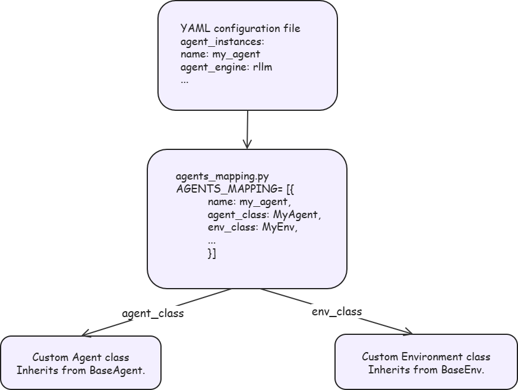

# Custom Agent Integration Guide

## Introduction

Agent SDK provides a flexible agent integration mechanism that allows you to integrate custom agents into the Aura training, inference, and tuning framework. You can implement the two core abstract classes `BaseAgent` and `BaseEnv` and register them in `agents_mapping.py` to let a custom agent participate in the reinforcement learning training loop.

### Core Concepts

The agent system of Agent SDK consists of the following core components:

| Component | Description |
|------|------|
| **Agent** | Interacts with the model, parses model output into tool calls, and maintains the conversation history |
| **Environment** | Executes tool calls and returns observations and reward signals |
| **Tool** | A tool that the agent can call, which defines the tool description and the execution logic |
| **Reward Function** | A reward function that evaluates the quality of agent behavior |
| **agents_mapping** | The agent registry, which maps names to specific Agent, Env, and Reward configurations |

### Architecture Overview



## Quick Start

### Step 1: Implementing a Custom Agent

A custom agent must inherit from [BaseAgent](../../../../aura/aura/runner/agent_engine_wrapper/base/agent/base_agent.py) and implement the following abstract methods:

```python
from aura.runner.agent_engine_wrapper.base.agent.base_agent import BaseAgent, Action, Step, Trajectory

class MyAgent(BaseAgent):
    def __init__(self, system_prompt="You are a helpful assistant.", **kwargs):
        """Initialize the agent state and set the system prompt"""
        self.system_prompt = system_prompt
        self._trajectory = Trajectory()
        self.messages = []
        self.reset()

    def update_from_env(self, observation, reward, done, info, **kwargs):
        """Receive environment feedback and format the observation as a message appended to the conversation history"""
        pass

    def update_from_model(self, response, **kwargs) -> Action:
        """Receive model output, parse it into tool calls, and record them in the trajectory"""
        pass

    def reset(self):
        """Reset the agent state and start a new episode"""
        pass

    @property
    def chat_completions(self):
        return self.messages

    @property
    def trajectory(self):
        return self._trajectory
```

**Key Methods:**

| Method | Responsibility | When It Is Called |
|------|------|---------|
| `update_from_env` | Receives environment feedback and formats it as a message | Each time the environment returns an observation |
| `update_from_model` | Parses model output into tool calls | Each time the model generates a response |
| `reset` | Resets the state and starts a new episode | At the start of each episode |
| `chat_completions` | Returns the current conversation history | When the model obtains the input during inference |
| `trajectory` | Returns the trajectory records | When training obtains rollout data |

> [!NOTE]
> For a complete implementation, see the built-in agent [ToolAgent](../../../../aura/agents/math_agent/tool_agent.py).

### Step 2: Implementing a Custom Environment

A custom environment must inherit from [BaseEnv](../../../../aura/aura/runner/agent_engine_wrapper/base/environment/base_env.py) and implement the following abstract methods:

```python
from aura.runner.agent_engine_wrapper.base.environment.base_env import BaseEnv

class MyEnvironment(BaseEnv):
    def __init__(self, *args, **kwargs):
        """Initialize the environment state"""
        pass

    def reset(self):
        """Reset the environment"""
        pass

    def step(self, action):
        """Execute the action"""
        pass

    @staticmethod
    def from_dict(env_args):
        """Construct an environment instance from the configuration dictionary"""
        pass
```

**Key Methods:**

| Method | Responsibility | Return Value |
|------|------|--------|
| `reset` | Resets the environment | `(observation, info)` |
| `step` | Executes one interaction step | `(observation, reward, done, info)` |
| `from_dict` | Constructs an instance from the configuration dictionary | A `BaseEnv` instance |

> [!NOTE]
> For a complete implementation, see the built-in environment [ToolEnvironment](../../../../aura/agents/math_agent/environment/tool_env.py).

### Step 3: Registering with `agents_mapping`

Add a custom agent configuration to the `AGENTS_MAPPING` list in [agents/agents_mapping.py](../../../../aura/agents/agents_mapping.py):

```python
from agents.my_agent.my_agent import MyAgent
from agents.my_agent.my_env import MyEnvironment

AGENTS_MAPPING = [
    # ... existing configurations ...
    {
        "name": "my_agent",
        "env_class": MyEnvironment,
        "env_args": {
            "max_steps": 10,
            ... # Other environment initialization parameters
        },
        "agent_class": MyAgent,
        "agent_args": {
            "parser_name": "qwen",
            "system_prompt": "You are a helpful assistant.",
            ... # Other agent initialization parameters
        },
    },
]
```

**Registration Entry Fields:**

| Field | Type | Description |
|------|------|------|
| `name` | str | Agent name. The `agent_name` field in the YAML file references this value |
| `agent_class` | type | Agent class that inherits from `BaseAgent` |
| `agent_args` | dict | Agent initialization parameters |
| `env_class` | type | Environment class that inherits from `BaseEnv` |
| `env_args` | dict | Environment initialization parameters |
| `compute_trajectory_reward_fn` | Callable | Trajectory-level reward computation function |
| `chat_parser` | type | Custom chat template parser |

### Step 4: Configuring the YAML File

Reference the custom agent in `agent_instances` of the training configuration YAML:

```yaml
agent_instances:
  - name: MY_AGENT
    executor_num: 1
    executor_kwargs:
      agent_engine: rllm
      agent_engine_kwargs:
        agent_name: my_agent          # Corresponds to name in agents_mapping
        simplify_think_content: false
        max_prompt_length: 4096
        max_model_len: 32768
        n_parallel_agents: 1024
        token_in_token_out: true
        env_args:                     # Merged into env_args in agents_mapping
          max_steps: 5
          tool_timeout: 200
          trajectory_timeout: 7200
        tokenizer: ${verl_conf.actor_rollout_ref.model.path}
      infer_service_params:
        temperature: 1.0
        top_p: 1.0
        max_tokens: 8192
        model: ${infer_instances.0.name}
      trajectory_save_dir: ${hydra:runtime.cwd}/outputs
    resource_info: []
```

**`agent_instances` Configuration Items:**

| Parameter | Description |
|------|------|
| `name` | Agent service name. The `agent_service` field in the training configuration references this value |
| `executor_num` | Number of agent executors |
| `executor_kwargs.agent_engine` | Agent engine type. Use `rllm` |
| `executor_kwargs.agent_engine_kwargs.agent_name` | Name of the agent registered in `agents_mapping` |
| `executor_kwargs.agent_engine_kwargs.env_args` | Environment parameters, which are merged with the `env_args` in `agents_mapping` |
| `executor_kwargs.infer_service_params` | Sampling parameters for model inference |
| `executor_kwargs.trajectory_save_dir` | Directory in which to save trajectories |

### Parameter Merging Mechanism

The parameters in `agent_engine_kwargs` of the YAML file are merged with the parameters registered in `agents_mapping`. The rules are as follows:

- `env_args`: The YAML configuration is merged with `agents_mapping`, and the values in the YAML file take precedence.
- `agent_args`: The YAML configuration is merged with `agents_mapping`, and the values in the YAML file take precedence.
- `tokenizer`: Injected automatically from `tokenizer: ${verl_conf.actor_rollout_ref.model.path}` in the YAML file.

For the source code of the merge logic, see [rllm_engine_wrapper.py](../../../../aura/aura/runner/agent_engine_wrapper/rllm/rllm_engine_wrapper.py):

```python
env_args = self.env_args | kwargs.get("env_args", {})
agent_args = self.agent_args | kwargs.get("agent_args", {})
```

## Built-in Agent Reference

Agent SDK provides the following built-in agents, which you can use as references for custom agents:

| Agent Name | Class | Description |
|------------|-----|------|
| `math` | [ToolAgent](../../../../aura/agents/math_agent/tool_agent.py) | Mathematical reasoning agent that supports the Python code execution tool |

## Source Code Implementation

| Component | Source Code Location | Description |
|------|---------|------|
| Agent registry | [agents/agents_mapping.py](../../../../aura/agents/agents_mapping.py) | Defines the configurations of all built-in agents and provides the `get_agent_by_name()` lookup |
| Agent base class | [base/agent/base_agent.py](../../../../aura/aura/runner/agent_engine_wrapper/base/agent/base_agent.py) | The `BaseAgent` abstract class, which defines the agent interface |
| Environment base class | [base/environment/base_env.py](../../../../aura/aura/runner/agent_engine_wrapper/base/environment/base_env.py) | The `BaseEnv` abstract class, which defines the environment interface |
| Agent executor | [agent_executor.py](../../../../aura/aura/runner/agent_service/agent_executor.py) | The `AgentExecutor`, which creates the RLLMEngineWrapper |
| Agent manager | [agent_manager.py](../../../../aura/aura/runner/agent_manager.py) | The `AgentManager`, which reads the configuration and creates executor instances |
| Agent router | [agent_router.py](../../../../aura/aura/runner/agent_router.py) | The `AgentRouter`, which routes requests to specific executors |
| RLLM engine | [rllm_engine_wrapper.py](../../../../aura/aura/runner/agent_engine_wrapper/rllm/rllm_engine_wrapper.py) | The `RLLMEngineWrapper`, the local agent execution engine |

## FAQ

**Q1: How Are the Parameters in `env_args` Passed to a Custom Environment**

The `env_args` in the YAML file are merged with the `env_args` in `agents_mapping` and then passed through `env_class.from_dict()`. A custom environment must implement the static `from_dict` method to parse these parameters.

**Q2: How Do I Debug a Custom Agent**

You can add logs in `update_from_model` and `update_from_env`, or set `trajectory_save_dir` to save trajectories to a JSONL file for offline analysis.

**Q3: Can a Custom Agent Work Without Tools**

Yes. If the agent does not need tool calls, return the `finish` action from `update_from_model` at all times. In this case, the agent behaves like a single-turn conversation, and the model output is the final answer.
