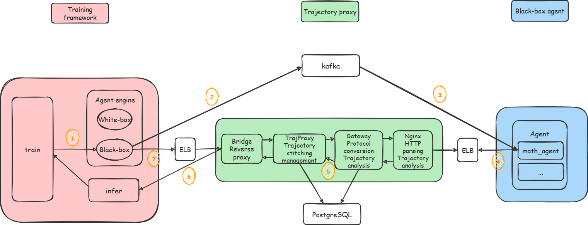

# Black-Box Agent Integration Guide

## Introduction

Black-box agent mode allows you to integrate an **external standalone agent service** into the Aura training framework so that it takes part in the reinforcement learning training loop (for example, GRPO). In this mode, the training framework treats the agent as a "black box": it only sends prompts over HTTP and waits for the results, without caring about the internal implementation logic of the agent.

### Use Cases

| Scenario | Description |
|------|------|
| **Existing agent system** | You already have a mature agent service (for example, one built on frameworks such as LangChain or CrewAI) and want to integrate it into RL training |
| **Multi-turn tool calling** | The agent must call tools multiple times (for example, Python execution or search) before it can complete the task |
| **Heterogeneous environment** | The agent runs in a different language, framework, or runtime environment. Therefore, it cannot run directly inside the training framework |

### Core Concepts

| Component | Description |
|------|------|
| **VAEE** (VirtualAgentEngineExecutionWrapper) | The "virtual engine" on the training framework side. It communicates with external agents over HTTP and handles trajectories and rewards |
| **AgentProxyClient** | The HTTP client that sends prompts to the external agent service |
| **TrajProxy** | The trajectory proxy service, which forwards the LLM inference requests of the agent and records trajectories |
| **TrajProxyClient** | The HTTP client that pulls trajectory records from TrajProxy |
| **External agent service** | The agent service that you implement yourself. It receives prompts, runs the agent loop, and returns results |
| **traj_refine_func** | The trajectory aggregation function, which aggregates the raw requests and responses recorded by TrajProxy into hierarchical trajectories (Episodes) |
| **res_reward_func** | The step-level reward function, which computes the intermediate reward for each step in a trajectory |

### Architecture Overview



## Quick Start

### Step 1: Deploying the Trajectory Proxy Service

#### Process

Use the third-party library [TrajProxy](https://github.com/infzo/TrajProxy) to start the trajectory proxy service on port 12300 (default).

1. Start the Aura container environment (mounting an NPU is not required) to run the TrajProxy service.

    Step 1: Pull the prebuilt image. This document uses an Atlas 900 A3 SuperPoD supernode (16 × 64 GB) running Ubuntu as an example:

    ```shell
    docker pull swr.cn-south-1.myhuaweicloud.com/ascendhub/agentsdk:26.2.0-cann9.0.0-torch_npu2.10.0-a3-ubuntu22.04-py3.11
    ```

    Step 2: Create a container:

    ```shell
    docker run --name your_container_name \
        --hostname agent \
        --network host \
        -it -d --shm-size=500g \
        --device=/dev/davinci_manager \
        --device=/dev/hisi_hdc \
        --device=/dev/devmm_svm \
        -v /usr/local/Ascend/driver:/usr/local/Ascend/driver \
        -v /usr/local/dcmi:/usr/local/dcmi \
        -v /usr/local/bin/npu-smi:/usr/local/bin/npu-smi \
        -v /etc/ascend_install.info:/etc/ascend_install.info \
        -v /usr/share/zoneinfo/Asia/Shanghai:/etc/localtime \
        -v /usr/local/sbin:/usr/local/sbin \
        swr.cn-south-1.myhuaweicloud.com/ascendhub/agentsdk:26.2.0-cann9.0.0-torch_npu2.10.0-a3-ubuntu22.04-py3.11  \
        sleep infinity
    ```

    Step 3: Enter the container environment.

    ```shell
    docker exec -it your_container_name bash
    ```

    Step 4: Update the code (recommended).

    The code in the prebuilt image is a snapshot taken at the time the image was built. Therefore, it may be inconsistent with the latest code on the release branch of the code repository. After you enter the container, you are advised to first check whether the latest commit of the local branch matches that of the corresponding remote branch, and to pull the latest code to update it if they do not match.

2. Download the code:

    ```shell
    cd /home/work/AgentSDK/aura/traj_proxy
    bash download_traj_proxy.sh
    ```

    The TrajProxy code is located in the `app` directory. Change `model_name` in `app/dockers/allinone/configs/config.yaml` to `Qwen3-8B`, and change `tokenizer_path` to the model path that corresponds to `Qwen3-8B`.

3. Install the dependencies:

    ```shell
    bash traj_proxy_install.sh
    ```

4. Initialize the service:

    ```shell
    bash traj_proxy_init.sh
    ```

5. Start the service:

    ```shell
    bash traj_proxy_start.sh
    ```

    Expected log after the service starts successfully:

    ```log
    (RemoteWorker pid=24896) INFO:     Started server process [24896]
    (RemoteWorker pid=24896) INFO:     Waiting for application startup.
    (RemoteWorker pid=24896) INFO:     Application startup complete.
    (RemoteWorker pid=24896) INFO:     Uvicorn running on http://0.0.0.0:12301 (Press CTRL+C to quit)
    ```

6. Send a request to TrajProxy to verify the service:

    ```shell
    curl -s http://0.0.0.0:12300/models | python3 -m json.tool
    curl http://0.0.0.0:12300/health
    ```

    The following log indicates that the TrajProxy service receives requests properly:

    ```log
    # curl -s http://0.0.0.0:12300/models | python3 -m json.tool
    {
        "status": "success",
        "count": 3,
        "models": [
            {
                "run_id": "app-001",
                "model_name": "Qwen3-8B",
                "tokenizer_path": "/path/to/models/Qwen3-8B",
                "token_in_token_out": true,
                "infer_client_url": "http://host.docker.internal:8000/v1"
            },
            {
                "run_id": "app_math_blackbox",
                "model_name": "/path/to/models/Qwen3-8B",
                "tokenizer_path": null,
                "token_in_token_out": false,
                "infer_client_url": "http://0.0.0.0:8080/v1"
            },
            {
                "run_id": "DEFAULT",
                "model_name": "Qwen3-8B",
                "tokenizer_path": null,
                "token_in_token_out": false,
                "infer_client_url": "http://host.docker.internal:8000/v1"
            }
        ]
    }

    # curl http://0.0.0.0:12300/health
    {"status":"ok"}
    ```

### Step 2: Deploying the Agent Service

#### Key Constraints for Integrating a Black-Box Agent into Training

The external agent service must implement an HTTP endpoint `POST /v1/chat/completions`. It receives the prompt sent by the training framework, runs the complete agent loop (multi-turn tool calling) internally, and returns HTTP 200 when it finishes.

**Request Format**:

```json
{
  "model": "Qwen3-8B",
  "messages": [
    {"role": "system", "content": "You are a math assistant..."},
    {"role": "user", "content": "Solve: 1+2+...+100 = ?"}
  ],
  "infer_params": {
    "temperature": 1.0,
    "top_p": 1.0,
    "max_tokens": 8192,
    "model": "/path/to/model"
  },
  "extra_params": {},
  "infer_url": "http://0.0.0.0:12300/s/app_math_blackbox/xxx,v1/"
}
```

**Core Constraint**: For each LLM call in the agent loop, the agent **must send the request to `infer_url`** (that is, TrajProxy) instead of calling vLLM directly. Only then can TrajProxy record the request and response of each inference step and forward the request to the Agent SDK inference side, so that the training framework can pull the trajectory later.

#### Process

1. Black-box agent integration constraint: the agent must adapt the `POST /v1/chat/completions` endpoint, which `AgentProxyClient` calls.

2. Use FastAPI to start the agent service on port 28124 (default). If you use a custom port, also change the `agent_proxy_args.agent_addr` configuration in the [co-located training configuration file](../../../../aura/configs/train/verl_train_hybrid_A3_t16_qwen3_8b_blackbox_math_fsdp.yaml).

    ```shell
    uvicorn path.to.math_agent.server:app --host 0.0.0.0 --port 28124
    ```

3. Send a request to the agent to verify the service:

    ```shell
    curl http://0.0.0.0:28124/health
    ```

    The following log indicates that the agent service receives requests properly:

    ```log
    # curl http://0.0.0.0:28124/health
    {"status":"ok"}
    ```

### (Optional) Step: Implementing the Trajectory Aggregation Function

A custom trajectory aggregation function (`traj_refine_func`) aggregates the raw request and response records (`List[RequestRecord]`) pulled from TrajProxy into hierarchical trajectories (`Episode`). If your scenario matches the default behavior, you can skip this step.

> [!NOTE]
> For a complete implementation, see the built-in trajectory aggregation function: [ozy_token_traj_refine_func](../../../../aura/agents/proxy_agent/math/ozy_traj_refine_reward.py).
> After you implement a custom function, also change `traj_refine_func` in the training configuration [co-located training configuration file](../../../../aura/configs/train/verl_train_hybrid_A3_t16_qwen3_8b_blackbox_math_fsdp.yaml) to the path of the corresponding function.

### (Optional) Step: Implementing the Reward Function

A custom trajectory-level reward function (`res_reward_func`) computes the final reward for an entire trajectory.

> [!NOTE]
> For a complete implementation, see the built-in trajectory aggregation function: [math_res_reward_fn](../../../../aura/agents/proxy_agent/math/ozy_math_reward.py).
> After you implement a custom function, also change `res_reward_func` in the training configuration [verl_train_hybrid_A3_t16_qwen3_8b_blackbox_math_fsdp.yaml](../../../../aura/configs/train/verl_train_hybrid_A3_t16_qwen3_8b_blackbox_math_fsdp.yaml) to the path of the corresponding function.

### Step 3: Starting Training

See the [Qwen3-8B Quick Start Guide](../../../../docs/en/aura/models/qwen3_8b.md), change the configuration file to the [co-located training configuration file](../../../../aura/configs/train/verl_train_hybrid_A3_t16_qwen3_8b_blackbox_math_fsdp.yaml) that **supports black-box agent integration**, and then start co-located mode training.

## Source Code Implementation

| Component | Source Location | Description |
|------|---------|------|
| VAEE Wrapper | [vaee_engine_wrapper.py](../../../../aura/aura/runner/agent_engine_wrapper/vaee/vaee_engine_wrapper.py) | The virtual engine, which encapsulates the black-box communication process |
| AgentProxyClient | [agent_proxy_client.py](../../../../aura/aura/runner/agent_engine_wrapper/proxy_client/agent_proxy_client.py) | The HTTP client that sends prompts to an external agent |
| TrajProxyClient | [traj_proxy_client.py](../../../../aura/aura/runner/agent_engine_wrapper/proxy_client/traj_proxy_client.py) | The HTTP client that pulls trajectories from TrajProxy |
| Default trajectory aggregation | [default_traj_refine.py](../../../../aura/aura/runner/agent_engine_wrapper/vaee/default_traj_refine.py) | The default trajectory aggregation function (step mode and token mode) |
| Default trajectory reward | [default_traj_reward.py](../../../../aura/aura/runner/agent_engine_wrapper/vaee/default_traj_reward.py) | The default trajectory-level reward function |
| Type definitions | [vaee_types.py](../../../../aura/aura/runner/agent_engine_wrapper/vaee/vaee_types.py) | Core types such as `RequestRecord`, `Step`, `Trajectory`, and `Episode` |

## Comparison with White-Box Agents

| Dimension | White-box agent (rllm) | Black-box agent (vaee) |
|------|-------------------|-------------------|
| Agent location | Inside the training framework | External standalone service |
| Communication | In-process calls | HTTP |
| Custom agent | Implement `BaseAgent` + `BaseEnv` | Implement an external HTTP service |
| LLM calls | Handled automatically by the framework | Managed by you, and they must go through `infer_url` |
| Trajectory recording | Recorded automatically by the framework | Recorded through TrajProxy forwarding |
| Use cases | Simple agent loops | Complex or heterogeneous agent systems |

## FAQ

**Q1: Must the External Agent Service Be Implemented in Python?**

No. It only needs to expose the `POST /v1/chat/completions` endpoint. Therefore, you can use any language or framework. The only requirement is that the LLM calls in the agent loop must go through `infer_url` (TrajProxy).

**Q2: Must `traj_refine_func` and `res_reward_func` Be Implemented?**

No. If you do not configure them, the framework uses the default `default_token_traj_refine_func` and `default_traj_reward_func`. You need custom functions only when the default behavior does not meet the requirements of your scenario.

**Q3: Which Error Conditions Must the External Agent Service Handle?**

The agent service must handle its own internal exceptions and ensure that it returns HTTP 200 (to prevent the training framework from retrying). If the agent loop fails, you can include the error information in the response body, and the training framework filters abnormal trajectories through the `error_traceback` field.

**Q4: What Is the Relationship Between Multiple Trajectories and `session_id`?**

Each `POST /v1/chat/completions` request corresponds to one `session_id`, and all LLM calls within a session are associated through the `session_id` in `infer_url`. TrajProxy stores trajectory records grouped by `session_id`, and the training framework pulls the complete trajectory through `GET /trajectory?session_id=xxx`.

**Q5: A Communication Problem Occurs During Deployment, and the Network Is Unreachable**

Check whether a network proxy is configured for each service. A single-node deployment does not need to access the external network. Therefore, delete the network proxy configuration.

```shell
unset http_proxy https_proxy HTTP_PROXY HTTPS_PROXY all_proxy ALL_PROXY
```
