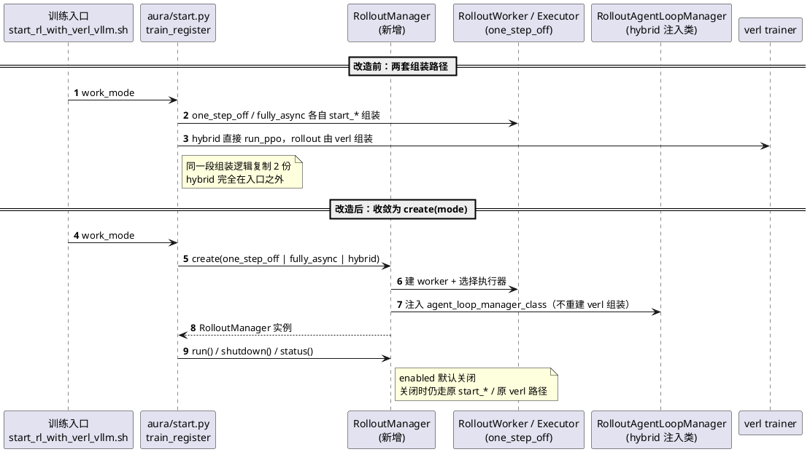
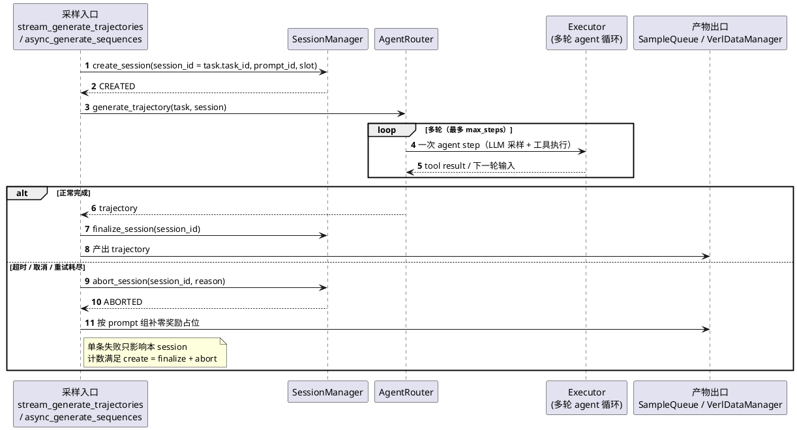

# 概述

## 简介

本提案描述了 Aura 框架中 Rollout 统一管理与会话生命周期能力的设计与实现。该能力在 hybrid / one_step_off / fully_async 三种训练模式之上补齐两层抽象：一是统一的 Rollout 入口契约（RolloutManager），二是可恢复、可中止、状态可查询的会话生命周期抽象（SessionManager）；同时提供可排空的优雅关闭语义与可申请申请登记、可释放的资源托管（RolloutResourceLedger）。

## 动机

Aura 当前三种模式共用同一个 shell 入口，但内部是两条完全不同的驱动路径：

- one_step_off / fully_async 走 start_rollout / start_fully_async_rollout，由 RolloutWorker + RolloutController + Executor 自主循环驱动，组装逻辑重复两份；
- hybrid 完全不走 start_*，由 verl trainer 自建 rollout replicas，并通过 HybridAgentLoopManager 驱动。

这带来四类问题：

1. **缺少统一入口契约**：同一段组装逻辑复制多份，hybrid 自建逻辑，启动方式与观测方式不一致。
2. **缺少 session 抽象**：采样是一次性请求，没有 create/finalize/abort 语义，无法以会话为单位管理一次 Agent 多轮交互；hybrid 路径甚至没有单条失败隔离（全量 create_task + 顺序 await，首个异常中断整批）。
3. **关闭不可排空**：进程退出时在途会话被直接杀掉，无法优先完成，且缺少可观测证据。
4. **资源回收不完整**：匿名 RolloutWorker、detached 命名 actor、aggregate 子进程等只在正常路径回收；fit() 异常、monitor os._exit、进程终止/OOM 时会残留。

## 提议方案

在现有 Aura 训推框架基础上，新增 RolloutManager、SessionManager、SessionStatusServer、RolloutResourceLedger 四个组件，按“先入口、再会话、再关闭、最后资源”的顺序分四个阶段递进落地；所有行为差异由 rollout_manager.enabled（默认关闭）门控，关闭时与改造前完全一致。

## 目标

整体目标如下：

- 三种训练模式共享同一套 create / run / shutdown / status 入口契约，用户以一致方式启动与观测 Rollout
- 以会话为单位管理一次 Agent 多轮交互：可正常结束、可被中止、状态可查询，单条会话失败不影响同批其他会话
- 训练停止后在途会话优先完成或被安全终止，不产生资源泄漏
- Rollout 占用的计算资源可被完整回收
- 原有启动方式保持可用，不重建 verl 内部组装、不改推理引擎

非目标：

- 不涉及新的强化学习算法设计，仅关注训练流程与生命周期管理
- 不涉及 PartialRollout（打断进行中的 rollout 并下次继续）特性
- 不涉及 KV 路由治理（请求落到哪个 vLLM instance），两条线独立互补
- 不涉及基于 NCCL/NIXL 的高效参数同步

## 方案设计

### 总体方案

系统仍以 Ray 为分布式框架，组件划分如下：

- **统一入口组件**：RolloutManager，收敛两个 start_* 并把 hybrid 的 agent_loop_manager_class 注入纳入同一 create(mode)
- **会话组件**：SessionManager，提供 create/finalize/abort/shutdown/get_status；开关关闭时退化为 NullSessionManager
- **状态出口组件**：SessionStatusServer，ThreadingHTTPServer 暴露 GET /session_status，三模式共用
- **资源管理组件**：RolloutResourceLedger，申请登记即申请、释放即注销
- **信号与排空组件**：TrainExecutor / TrainRouter / start.py，负责信号接收、取消投递、driver 侧排空与等待
- **既有组件（不改）**：RolloutWorker、RolloutController、Executor、SampleQueue / VerlDataManager、verl 内部组装

整体流程如下：

1. 入口按 work_mode 调用 RolloutManager.create，完成组装与就绪校验
2. 采样入口为每条 task 创建 session，正常完成 finalize，异常/取消/重试耗尽 abort
3. 每轮末尾输出 sessionmgr.status 汇总，状态端点返回同一份计数
4. 训练结束或收到 SIGINT/SIGTERM：先排空（等 active 归零，超时则 abort），再释放资源
5. 信号路径下 rollout task 被取消时，释放移交 driver，由 driver 在排空完成后输出同格式证据

### 技术选型

选择“统一入口 + 进程内会话抽象”的理由：

- 与现有代码架构兼容性好：训推分离模式的并发、超时、聚合、解耦已同构，改造重心是补抽象而不是重写采样流水线
- 降级友好：rollout_manager.enabled 默认关闭，关闭后零新增日志、行为与改造前一致

### 功能与性能设计

**统一入口流程**：

- create(mode, **ctx) 三训练模式组装：one_step_off / fully_async 建 worker + controller + 对应 executor；hybrid 只改写 actor_rollout_ref.rollout.agent.agent_loop_manager_class 并注入 extras.rollout_manager
- 就绪校验只保留失败后无法自愈的三项：infer_service 非空、status_port 可绑定、hybrid 的 hybrid_engine=true；校验失败即 create 失败，不进入半启动状态
- run() 语义按模式不同：训推分离模式阻塞 executor.fit()；训推共卡模式立即返回，由 verl trainer 驱动

**会话管理与失败隔离流程**：

- session_id 直接复用 task.task_id，prompt_id 用于按组统计与占位
- 训推分离模式在 stream_generate_trajectories.worker_with_retry：create → await → finalize；TimeoutError / CancelledError / 重试耗尽分别 abort，reason 取 timeout / cancelled / retry_exhausted
- 训推共卡模式在 HybridAgentLoopManager.async_generate_sequences：显式 create_task、gather(return_exceptions=True)、retry_limit、CancelledError 收尾，单条失败只 abort 本会话
- 失败会话按同一 prompt 组补零奖励占位（训推共卡模式产出 Episode，训推分离模式产出 dict），保证 n_samples_per_prompt 组完整

**超时策略**：

- enabled=true：rollout 侧不设置轨迹超时（trajectory_timeout=None），长轨迹不因超时被 abort；两阶段取消只由取消路径触发
- enabled=false：保持改造前行为，one_step_off / fully_async 按 rollout_config.trajectory_timeout 超时，hybrid 在 else 分支按 extras.trajectory_timeout 超时
- agent engine 侧 env_args.trajectory_timeout（缺省 7200s）不参与门控，作为最终兜底，超时以 termination_reason=TIMEOUT 正常收尾

**优雅关闭流程**：

- 训推分离模式：RolloutManager.shutdown 固定三段 _drain_sessions → _release → 退出；drain 通过 ray.get(worker.drain_sessions(timeout), timeout+5s) 完成
- 训推共卡模式：drain 放在 HybridTaskRunner.run 的 finally，显式传 session_drain_timeout，随后打 manager.shutdown.status 快照并 stop_status_server
- 信号路径：start.py 注册 SIGINT/SIGTERM → TrainRouter.cancel_active 先提交 drain、再取消训练任务 → driver 以 session_drain_timeout 等待 rollout ref → 超时 force cancel → 以 shutdown_hard_limit 等待 train ref

**资源回收流程**：

- 按申请登记顺序释放，每项独立线程 + join(timeout)，超时或异常只计 failed，不阻断后续项
- owned：RolloutWorker、rollout_weight_manager、rollout_queue、rollout_server、session_status
- external：rollout/weights_*、iter_* 与 checkpoint、外挂 vLLM，只申请登记不释放
- delegated：hybrid 的 Actor / RolloutWorker / PG / NPU 由 verl 持有，只申请登记预期项并输出交接证据，不越权 kill

### 数据模型

会话状态：

- SessionState：CREATED / FINISHED / ABORTED
- 计数器：active / finished / aborted / placeholder，进程内加锁维护
- 状态载荷：{mode, enabled, running, source, status_port, sessions, placeholder}，其中 source 取 worker / local / trainer，hybrid 的 sessions 为 null（driver 无会话，避免假 0）

资源台账：

- ResourceEntry(kind, name, disposer=None, timeout=DEFAULT_RELEASE_TIMEOUT)
- kind：actor / named_actor / http / process / delegated
- disposer 为 None 表示只申请登记不释放（external / delegated）

## 编程与调用设计

### 编程模型基本设计

开发约束：

- 需要配置 Ray 集群环境与对应训推模式的 yaml
- 数据需预处理为指定格式
- 需合理设置 session_drain_timeout（应不小于单条会话 P99）与 shutdown_hard_limit

可验收设计：

- 提供示例配置文件
- 实现端到端测试用例
- 所有新增日志统一前缀 [AURA_ROLLOUT]

## 接口定义与设计

### RolloutManager

接口描述：RolloutManager 是三训练模式统一入口，负责组装、运行、排空、释放与状态查询。工厂与实例合并为一个类，create 无状态，实例承载运行期状态。

接口原型：

```python
class RolloutManager:
    def __init__(self, mode, enabled=False, status_port=18080,
                 worker=None, controller=None, executor=None,
                 agent_loop_manager_cls=None, train_config=None, rollout_config=None,
                 session_drain_timeout=30.0):
        pass

    @classmethod
    def create(cls, mode, **ctx) -> "RolloutManager":
        pass

    def run(self) -> None:
        pass

    def shutdown(self, timeout: float = None) -> None:
        pass

    def status(self, log: bool = True) -> dict:
        pass

    @property
    def worker_handle(self):
        pass
```

输入参数：

- mode: hybrid / one_step_off / fully_async，非法模式抛 ValueError
- ctx: rollout_config、train_config、agent_service、infer_service
- timeout: 排空预算，缺省取 rollout_manager.session_drain_timeout

返回参数：

- create 返回实例；status 返回 {mode, enabled, running, source, status_port, sessions, placeholder}
- shutdown 无返回，内部固定三段：drain → release → 停状态端点

### SessionManager

接口描述：SessionManager 是会话注册表，负责一次 Agent 多轮交互的生命周期跟踪与计数。

接口原型：

```python
class SessionState(enum.Enum):
    CREATED = "created"
    FINISHED = "finished"
    ABORTED = "aborted"

class SessionManager:
    def __init__(self, enabled=True):
        pass

    def create_session(self, session_id, prompt_id=None, slot=None) -> str:
        pass

    def finalize_session(self, session_id, steps=None) -> None:
        pass

    def abort_session(self, session_id, reason="") -> None:
        pass

    def record_placeholder(self, prompt_id, index=None, session_id=None) -> None:
        pass

    def shutdown(self, timeout=0.0, poll_interval=0.05) -> int:
        pass

    def get_status(self) -> dict:
        pass

    def log_status(self) -> None:
        pass
```

输入参数：

- session_id: 复用 task.task_id
- prompt_id: 用于按组统计
- timeout: drain 等待上限，超时后对剩余会话按 reason=shutdown 逐条 abort

返回参数：

- shutdown 返回被 abort 的会话数
- get_status 返回 {active, finished, aborted, placeholder}

开关关闭时使用 NullSessionManager：状态计数恒为 0，所有方法直通且不输出日志。

### SessionStatusServer

接口描述：SessionStatusServer 是会话状态的统一 HTTP 出口，三模式共用同一实现；状态由回调提供，所有训推模式均复用。

接口原型：

```python
class SessionStatusServer:
    def __init__(self, port, status_cb, host="0.0.0.0", max_port_tries=10, mode="executor"):
        pass

    def start(self) -> str | None:
        pass

    def stop(self) -> None:
        pass

    @property
    def addr(self) -> str | None:
        pass
```

输入参数：

- port: 起始端口（rollout_manager.status_port，默认 18080），被占用则顺延，最多尝试 10 个
- status_cb: 返回 JSON 可序列化状态字典的回调

返回参数：

- start 返回实际绑定的 host:port，全部端口占用时返回 None
- GET /session_status 返回与同轮 sessionmgr.status 一致的计数

### RolloutResourceLedger

接口描述：RolloutResourceLedger 负责 owned 资源的申请登记、幂等释放。

接口原型：

```python
@dataclass
class ResourceEntry:
    kind: str
    name: str
    disposer: Optional[Callable[[], None]] = None
    timeout: float = DEFAULT_RELEASE_TIMEOUT

class RolloutResourceLedger:
    def __init__(self, log_enabled=False):
        pass

    def acquire(self, entry) -> None:
        pass

    def release_all(self, reason="shutdown") -> dict:
        pass
```

输入参数：

- entry: 资源条目；disposer 为 None 表示 delegated / external，只申请登记不释放
- reason: shutdown / create_failed，用于证据自描述

返回参数：

- release_all 返回 {owned, released, failed, items}，items 为按释放顺序排列的 (kind, name, status)

### RolloutWorker（会话与释放相关接口）

接口描述：RolloutWorker 在统一管理下提供会话计数、排空、释放与停止能力；原有采样接口签名不变。

接口原型：

```python
class RolloutWorker:
    def get_session_status(self) -> dict:
        pass

    async def drain_sessions(self, timeout=0.0) -> int:
        pass

    async def release(self) -> bool:
        pass

    def stop(self) -> bool:
        pass

    async def stream_generate_trajectories(self, agent_tasks, agent_router,
                                           mode="Text", concurrency=64):
        pass
```

输入参数：

- timeout: 服务端排空预算；worker 内部预留 30s 回程余量后再等待 active 归零

返回参数：

- release 返回 True 表示本次完成释放，False 表示已被释放（幂等）
- stop 返回 True 表示本次执行停止，重复调用返回 False

### RolloutAgentLoopManager（hybrid 注入类）

接口描述：RolloutAgentLoopManager 是 RolloutManager 注入的 hybrid 采样管理类，在 trainer 进程内自建 SessionManager 与状态端点，并暴露与 RolloutWorker 对齐的宿主接口。

接口原型：

```python
class RolloutAgentLoopManager(HybridAgentLoopManager):
    def get_session_status(self) -> dict:
        pass

    def cancel_inflight(self) -> int:
        pass

    def drain_sessions(self, timeout=0.0) -> int:
        pass

    def log_shutdown_status(self) -> None:
        pass

    def stop_status_server(self) -> None:
        pass
```

### TrainExecutor / TrainRouter（信号与排空）

接口描述：TrainExecutor 持有训练任务 ref 与 rollout 句柄；TrainRouter 在 driver 侧承担排空等待与释放接管，因为 driver 不会被同一个 ray.cancel 打断。

接口原型：

```python
class TrainExecutor:
    def register_rollout(self, payload=None) -> None:
        pass

    def get_rollout_future(self) -> dict:
        pass

    def cancel(self, signal_name="SIGTERM", target="start_train") -> bool:
        pass

class TrainRouter:
    @classmethod
    def cancel_active(cls, signal_name="SIGTERM", timeout=10.0) -> int:
        pass
```

调用参考代码：

```python
# one_step_off：rollout task 的 finally
manager = RolloutManager.create("one_step_off", rollout_config=cfg,
                                agent_service=agent_service, infer_service=infer_service)
try:
    manager.run()
finally:
    manager.shutdown()

# hybrid：注入后立即返回，由 verl trainer 驱动
RolloutManager.create("hybrid", train_config=train_config,
                      rollout_config=rollout_config).run()
```

## 模块时序图

### 时序图

两张图分别对应：统一入口收敛、单次采样会话生命周期。

**① 统一入口收敛**



说明：入口只保留一条 `create(mode)` 分支，hybrid 不再绕过入口，而是通过注入 `agent_loop_manager_class` 接入同一契约。

**② 单次采样会话生命周期**



说明：`session_id` 复用 `task.task_id`；失败会话只 abort 自身，并按同一 prompt 组补零奖励占位，保证 `n_samples_per_prompt` 组内样本完整。

## 文档设计

编程手册将包含以下内容：

- 配置文件说明（rollout_manager.enabled / status_port / session_drain_timeout / shutdown_hard_limit）
- API 参考文档（RolloutManager / SessionManager / SessionStatusServer / RolloutResourceLedger）
- 示例代码与使用案例

## 缺点和风险

1. **实现复杂度**：相比单一模式，统一管理涉及入口收敛、会话状态、信号链、排空等待与资源台账多组件协调，跨进程状态无法共享（hybrid 与 driver 不同进程，必须各建实例）。

2. **数据一致性**：失败会话以零奖励占位补齐是唯一有数据语义风险的点，可能引入训练偏移；占位补齐策略需与 n_samples_per_prompt 语义保持一致。

3. **长尾占用**：enabled=true 时 rollout 侧不再有轨迹超时，长尾会话会一直占用并发槽位（one_step_off 的 Semaphore、hybrid 的 gather），只能依靠 engine 兜底、max_steps、tool_timeout 与人工/调度级超时。

## 应对措施

- 提供详细文档与参数配置指南，明确 session_drain_timeout 应不小于单条会话 P99
- 提供统一日志前缀与验收模板，降低排查成本
- 所有行为差异由 rollout_manager.enabled 门控，支持快速回退；资源释放不受门控，保证回退不泄漏
- 占位补齐仅补组内数量、不参与真实采样统计，并通过对比开关前后 loss 与 reward 曲线验证无偏移

## 现有技术

本方案借鉴了以下技术：

- **Aura 既有能力**：SampleQueue / VerlDataManager 的 producer-consumer 解耦、stream_generate_trajectories 的并发限流与重试、RolloutController 的权重版本管理
- **uni-agent 框架层**：AgentFramework + AgentFrameworkRolloutAdapter 的统一入口契约，GatewayManager 的 create/finalize/abort/shutdown 会话语义与三层并发聚合
- **verl**：agent_loop_manager_class 契约、hybrid 引擎的 actor/rollout replica 组装
- **Ray 分布式计算框架**：Actor 模型、命名 actor、ray.cancel 两阶段取消、ObjectRef 生命周期

与其他方案的差异：

- 不重建 verl 内部组装，hybrid 只做注入
- 三模式统一的是 create / shutdown / status，不强行统一驱动方式

## 验收标准

在 Atlas A2 / A3 系列产品上，Agent SDK 训推调框架支持三种工作模式的 Rollout 统一管理与会话生命周期管理。

1. 使用 Qwen3-8B 模型，在GSM8K 数据集执行训练；
2. 完成一轮训练，Rollout产出正常，精度无损；
3. Agent RL 端到端训练轨迹利用率提升10%。

硬件：Atlas A2 系列产品、Atlas A3 系列产品
OS：Ubuntu 22.04 LTS

## 其他补充说明

无
