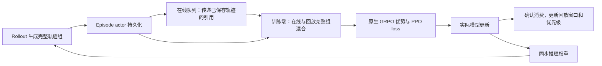

# 轨迹经验回放使用指南

## 简介

轨迹经验回放将历史完整轨迹保存到 Episode Store，按 GRPO 完整组采样，与新生成的在线样本组成训练批次。它支持 `uniform`、`priority`、`reward_weighted` 三种策略，可选择启用模型与回放状态配对恢复，以及冻结轨迹库的只读跨实验复用。

默认 `replay_ratio=0` 保持原训练路径，不创建回放 actor、轨迹库或采样随机数生成器。回放不保证模型质量一定提高；不同策略应使用相同模型、数据和评估方法比较。

### 适用范围

- Aura `one_step_off`、verl、trajectory-level GRPO，`hybrid_batch_num=1`。
- FSDP/FSDP2、新版 verl engine worker、原生 `vanilla` PPO loss。
- 固定 verl 依赖为 `e9972368aa6a6078eacd7f0678bdfdd0196ce7b5`，以仓库环境构建配置为准。
- 正比例回放不支持 `fully_async`、stepwise advantage 或模型单独恢复指针。
- 存储采用 SQLite 或 JSON，生产写入统一经过 Ray Episode actor。

### 运行过程



同一 prompt 的组成员一起进入批次，禁止拆组或用失败占位轨迹补齐。真实生成但被 `overlong_filter` 全部屏蔽 loss 的成员保留原 mask 和组位置。窗口只接纳成功训练的在线组；淘汰窗口组不删除磁盘历史轨迹。

## 使用方法

### 步骤 1：准备原有 one-step-off 环境

先按[训推单步异步分离模式使用指南](./03_one_step_off.md)设置 `hosts.conf`、`base.conf`、模型、数据集、推理配置和 Hydra 搜索路径。每个实验使用独立目录和运行组件，不复用另一个仍在运行的训练管理器。

本指南不额外启动预检训练，也不设置按运行时长自动停止的规则。

### 步骤 2：选择示例配置

使用[回放示例配置](../../../../aura/configs/train/verl_train_async_replay_example.yaml)。它基于仓库现有 Qwen3-8B one-step-off 配置，已加入回放参数；需要按文件顶部说明修改模型、数据、搜索路径和实际卡数。

```shell
# configs/base.conf
work_mode=one_step_off
train_config_name=verl_train_async_replay_example
infer_config_name=vllm_infer_i16_qwen3_8b
```

运行前替换示例中的存储路径、实验身份和签名。签名应对应实际模型、分词器及对话模板、任务和奖励函数，不能把说明占位符当作可跨实验复用的凭证。当前不自动计算全部模型和模板指纹。

### 步骤 3：设置回放参数

参数位于总配置的 `verl_conf.replay`，并随 `train_config` 传入训练入口，无需手动创建 Episode actor。

| 参数 | 作用与约束 |
| --- | --- |
| `replay_ratio` | 0～1；0 关闭，0.3 表示按完整组累计实现约 30% 回放 |
| `replay_buffer_size` | 活跃窗口容量，单位为 trajectory，按完整组管理 |
| `replay_strategy` | `uniform`、`priority` 或 `reward_weighted` |
| `max_lag` | 只消费满足 `0 <= 当前版本 - 生成版本 < max_lag` 的组 |
| `seed` | 回放采样使用的独立随机种子 |
| `backend`、`path` | `sqlite`/`json` 及本实验独立的绝对持久化路径 |
| `warmup_online_steps` | 前若干步只消费在线组，用于建立回放窗口 |
| `online_prefetch` | 预取下一批必需的在线样本，保持有界队列 |
| `rpc_timeout` | 等待 actor/在线批次的超时秒数，不是训练时长限制 |
| `priority_alpha`、`priority_epsilon` | 优先级指数及正数平滑项，默认 1 和 1e-6 |
| `reward_temperature` | 奖励加权 softmax 的正数温度，默认 1 |

`group_size` 和 `batch_groups` 从实际 `rollout.n`、`data.train_batch_size` 推导；训练和 rollout 的组大小、全局 prompt batch 必须一致。`actor_name` 由启动器生成。

三种采样策略都按完整组不放回抽样：

- **uniform**：候选组等概率采样。
- **priority**：从本次原生 GRPO 优势计算每条轨迹有效 token 的平均 `abs(advantage)`，再对组成员取平均；全屏蔽成员贡献为 0。权重为 `(priority + epsilon)^alpha`，无需 critic。
- **reward_weighted**：对组内原始奖励取均值，再按温度计算 softmax 权重，支持负奖励。

`0 < replay_ratio < 1` 时，回放候选不足用在线完整组补齐。`replay_ratio=1` 时，必须先通过在线预热或兼容只读源建立至少一个完整批次的候选；纯回放阶段不足或全部过期明确报错，不偷偷生成在线样本。预热步不计为纯回放步骤。

### 步骤 4：启动与观察

按 one-step-off 指南的原有启动命令运行。生产端按完整组及编码字节数拆分持久化请求，每批最多 256 条、64 MiB；单个完整组超过限制时在首次写入前报错，需要缩短序列或减小组大小。

关注训练日志中的 `replay/actual_ratio`、`replay/actual_groups`、`replay/fallback_groups`，以及 IS 裁剪统计。配置比例与逐步实际比例可能因完整组取整、预热或候选不足而不同。

行为概率修正只执行一次：`clip(exp(log_pi_old - log_pi_behavior), 0.5, 2)`。PPO 的 current/old ratio 仍由原生 loss 处理。组抽样概率不是 token 行为概率，不作为 `1/p` 再乘一次 loss。示例关闭了其他 IS/RS 和权重批归一化，避免重复修正。

## 配对保存与断点恢复

需要恢复时，在 `verl_conf` 增加以下配置，并保持每个版本恰好一次优化器更新：

```yaml
trainer:
  resume_mode: disable
  default_local_dir: /workspace/my-run/checkpoints
  default_hdfs_dir: null
  del_local_ckpt_after_load: false
actor_rollout_ref:
  actor:
    ppo_epochs: 1
    ppo_mini_batch_size: ${verl_conf.data.train_batch_size}
    checkpoint:
      save_contents: [model, optimizer, extra, hf_model]
      load_contents: [model, optimizer, extra]
async_training:
  trigger_parameter_sync_step: 1
replay_recovery:
  enabled: true
  root: /workspace/my-run/checkpoints
  ledger_path: /workspace/my-run/consumer-ledger.sqlite
  branch: initial
  writer_request: unique-initial-owner
```

根目录应预先存在，采用训练端和 actor 均可访问、支持 fsync/hardlink 的本地文件系统；不支持 HDFS/对象存储路径映射。

模型更新后先由所有 FSDP rank 确认实际 optimizer/scheduler 版本，再确认消费。保存时停止新的生成准入、等待在途生成和预取完成，保存模型、优化器、调度器、RNG、队列、游标与回放窗口，最后发布 `COMMITTED.json`。消费 ACK 本身不是模型恢复点。

完整历史在线组保存在 actor 的索引账本中；快照只携带当前窗口、待消费组、计数和随机状态。已淘汰组仍受重复消费检查。恢复新分支只继承所选提交点之前的历史，不继承该点之后未配对的消费。

恢复时保留原轨迹库、账本、根目录和语义配置，改用新的 `branch`、`writer_request`，增加 `from_branch: initial`；可用 `commit_id` 指定完整点。先确认旧训练已结束或隔离，再启动新 worker。所有推理实例加载对应权重并成功清理 prefix cache 后才允许生成。

模型更新失败、梯度异常导致更新跳过、ACK 状态不确定或恢复校验失败时停止当前会话，从配对点恢复，不自动重复更新。

**格式边界：**本轮检视修复采用 mixer-state v2 和 ledger schema v2，以支持紧凑快照；不自动迁移开发期间的 v1 账本/配对点。旧实验文件应保留，并使用对应旧版代码读取；新运行使用新目录。

## 只读跨实验复用

复用指把另一个已完成实验的冻结轨迹作为候选。必须明确选择源组，核对模型、分词器/模板、任务和奖励签名，并证明源策略版本与目标版本对应相同策略权重；不能仅凭模型名称或版本差值猜测映射。

在 `verl_conf.replay` 增加：

```yaml
reuse_sources:
  - backend: sqlite
    path: /workspace/frozen-source/episodes.sqlite
    sha256: REPLACE_WITH_SOURCE_SHA256
    store_id: source-store
    source_experiment_id: source-experiment
    source_run_id: source-run
    policy_lineage_id: source-lineage
    group_ids: [exact-group-1, exact-group-2]
    versions:
      - source_version: 11
        target_version: 0
        source_policy_path: /workspace/frozen-source/policy-manifest.json
        target_policy_path: /workspace/my-run/initial-policy-manifest.json
        policy_sha256: REPLACE_WITH_IDENTICAL_POLICY_SHA256
```

SHA 占位符必须换成真实的 64 位小写摘要。策略文件或完整权重清单需有可信运行证据证明版本归属；SHA 相等本身不证明历史关联。源 SQLite 应停止 writer、完成 WAL checkpoint 后冻结，JSON 源也须停止写入。源库只读，本实验新轨迹、优先级和消费账本写到目标目录；源路径不可与目标路径重叠。

版本映射必须逐项提供、严格递增且单射，不自动外推。最大 16 个源、每源 4096 个显式组和 256 个版本对；初始复用组必须装入回放窗口。原始行为概率和来源版本不修改，目标消费时使用映射后的版本判断 lag。priority 的源组以中性分数 1 启动，成功消费后用本实验的实际优势刷新。

## 验证与资料

本指南说明使用契约，不把历史实验指标视为每个新提交已验证的结果。2026-11-13 检视修复的服务器回归尚待执行；性能和恢复结论须以对应提交的复验记录为准。

详细设计、历史自验报告与本轮逐条处理记录见[固定资料归档](https://gitcode.com/m0_64481238/AgentSDK/tree/976cde9fbef62e179b5f1da57cc785094b47b942/experiments/issue158/pr1086-review/20261113)；由开发者在 [Issue #158](https://gitcode.com/Ascend/AgentSDK/issues/158) 评论中归档，避免将开发阶段报告作为分散的用户指南提交。
