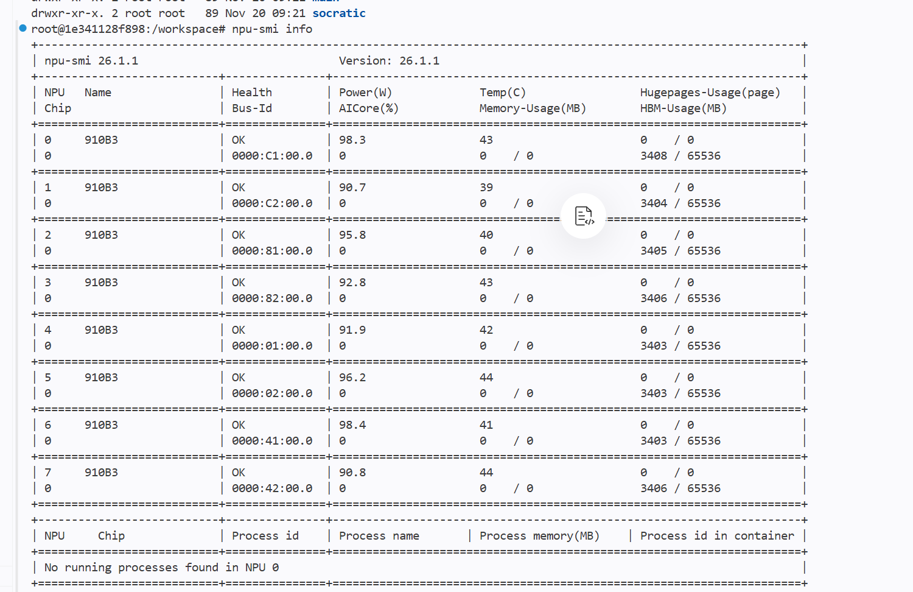
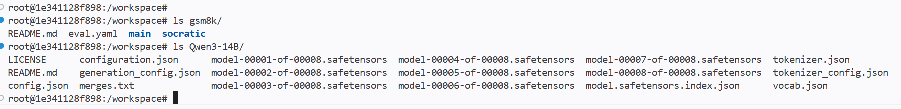
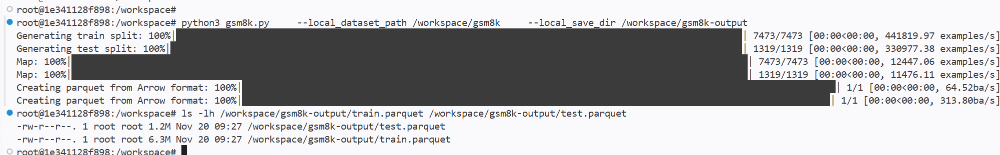
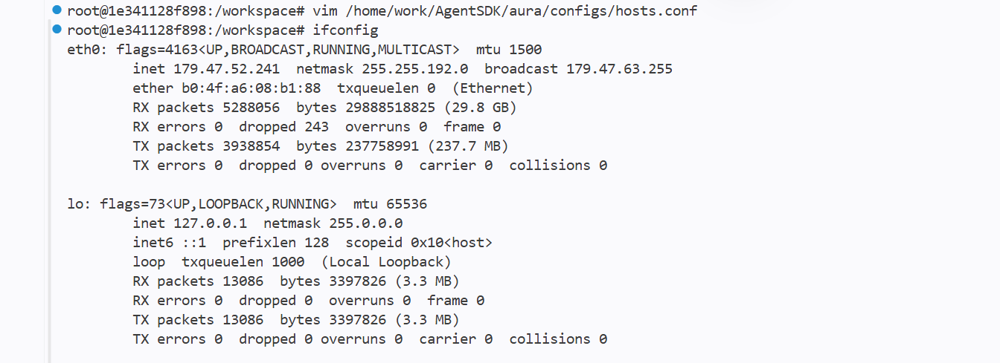
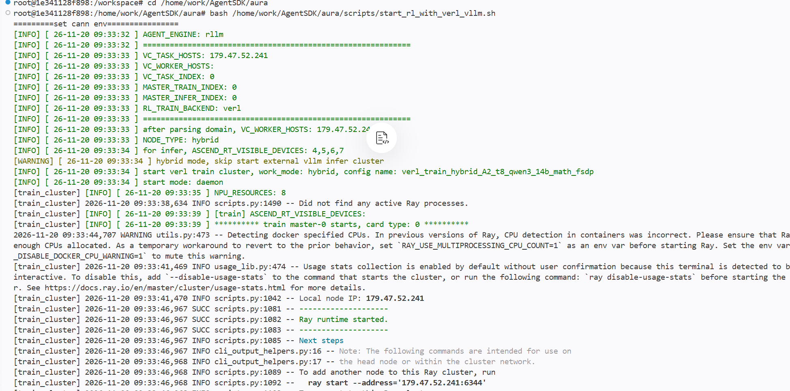
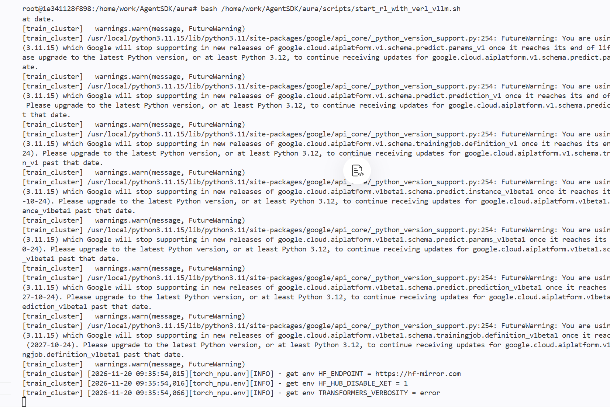
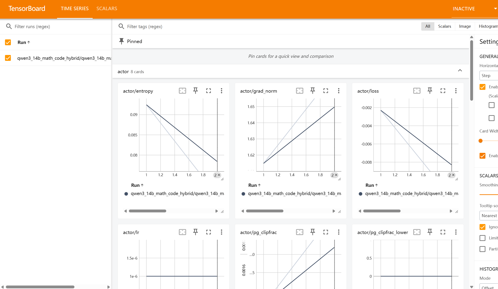
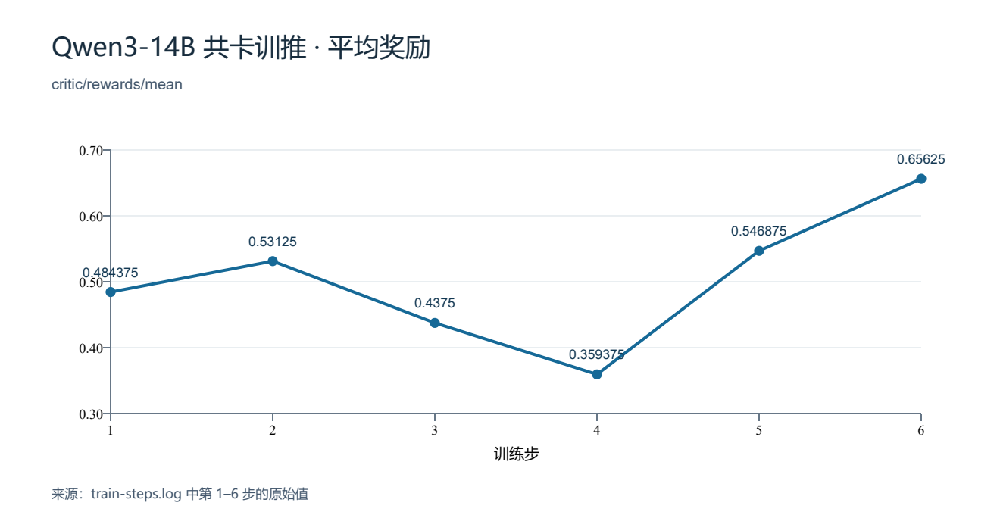

# 基于AgentSDK完成Qwen3-14B共卡模式训推任务 总结报告

> **一句话结论**：Qwen3-14B 在 A2 八卡上跑通共卡训推。第 1–6 步的平均 reward 有波动，首末值从 0.484375 升至 0.65625。

## 1 文档信息

| 项目 | 内容 |
| --- | --- |
| 文档类型 | 验证报告 |
| 提交人 | GitCode ID：LikeWindc |
| 文档版本 / 日期 | v1 / 2026-11-20 |

## 2 任务背景与目标

- **任务目标**：在 A2 八卡上运行 Qwen3-14B 共卡训推，查看平均 reward 和另一项训练指标。
- **任务结果**：已完成 GSM8K 预处理、共卡启动和指标可视化。运行日志记录了连续 6 步的平均 reward，TensorBoard 截图记录了前两步的 `actor/loss`。

## 3 环境准备

### 3.1 环境创建步骤

**步骤 1：申请 / 创建算力环境**

- 操作：使用 A2 八卡活动实例。
- 截图：待补 `01_env_create.png`。

**步骤 2：选择镜像**

- 操作：活动指定镜像为【应用使能】AgentSDK。
- 截图：待补 `02_env_image.png`。

**步骤 3：启动并登录开发环境**

- 操作：在容器 `1e341128f898` 的 `/workspace` 目录开始实操。终端提示符见下图。

### 3.2 环境信息

`npu-smi info` 显示 8 张昇腾 910B3（编号 0–7），健康状态均为 OK，每卡 HBM 总量为 65536 MB。



## 4 实际执行步骤

- **任务入口文档**：[Qwen3-14B 共卡快速入门](https://gitcode.com/Ascend/AgentSDK/blob/master/docs/zh/aura/models/qwen3-14b_quick_start/qwen3-14b-hybrid.md)
- **样例 / 代码路径**：[启动脚本](https://gitcode.com/Ascend/AgentSDK/blob/master/aura/scripts/start_rl_with_verl_vllm.sh) · [数据预处理脚本](https://github.com/verl-project/verl/blob/v0.7.0/examples/data_preprocess/gsm8k.py)
- **是否修改样例代码**：现场记录了运行配置调整。

### 步骤 1：下载模型和数据

```bash
modelscope download --model Qwen/Qwen3-14B --local_dir /workspace/Qwen3-14B
modelscope download --dataset AI-ModelScope/gsm8k --local_dir /workspace/gsm8k
```

- **预期**：模型权重和原始数据可读取。
- **实际**：模型目录列出全部 8 个权重分片和索引文件，GSM8K 目录中可见 `main` 和 `socratic`。
- **截图**：

### 步骤 2：预处理 GSM8K

```bash
python3 gsm8k.py --local_dataset_path /workspace/gsm8k --local_save_dir /workspace/gsm8k-output
```

- **预期**：生成训练和测试用的 Parquet 文件。
- **实际**：训练集 7473 条，测试集 1319 条；`train.parquet` 和 `test.parquet` 均已写入 `/workspace/gsm8k-output`。
- **截图**：

### 步骤 3：配置共卡训练

- **预期**：启动时使用 Qwen3-14B 的 A2 八卡训练配置。
- **实际**：启动日志显示配置名为 `verl_train_hybrid_A2_t8_qwen3_14b_math_fsdp`，见步骤 5。YAML 配置截图待补 `07_train_yaml.png`。

### 步骤 4：确认通信网卡

```bash
vim /home/work/AgentSDK/aura/configs/hosts.conf
ifconfig
```

- **预期**：确认单机通信网卡和节点地址。
- **实际**：使用 `eth0`，启动日志中的节点地址与该网卡一致。
- **截图**：

### 步骤 5：启动共卡训推

```bash
cd /home/work/AgentSDK/aura
bash /home/work/AgentSDK/aura/scripts/start_rl_with_verl_vllm.sh
```

- **预期**：以 hybrid 模式启动八卡训推。
- **实际**：启动终端显示 `NODE_TYPE: hybrid`、`NPU_RESOURCES: 8` 和 `Ray runtime started`。附件为[训练进程启动日志节选](train-start.log)。
- **截图**：

### 步骤 6：查看运行日志

```bash
ls -t /home/work/AgentSDK/aura/logs/train_unit_*.log | head -n 1 | xargs -r tail -n 30
```

- **预期**：推理引擎完成初始化，开始记录训练步。
- **实际**：两个推理引擎完成预热。[运行日志节选](train-steps.log)中，`training/global_step` 从 1 连续记录到 6。
- **截图**：

### 步骤 7：查看 TensorBoard 指标

```bash
tensorboard --inspect --logdir /home/work/AgentSDK/aura/tensorboard_log
tensorboard --logdir /home/work/AgentSDK/aura/tensorboard_log --port 6688
```

- **预期**：看到平均 reward 和另一项指标随训练步数的变化。
- **实际**：TensorBoard 已显示 `critic/rewards/mean` 标签和第 1、2 步的 `actor/loss`，这两步的 loss 下降。第 1–6 步的平均 reward 见下节日志曲线。
- **截图**：

## 5 执行结果

- **结论**：八卡共卡训推和指标可视化通过。观察到的 6 步中，平均 reward 在第 4 步降至 0.359375，第 6 步回升至 0.65625，较第 1 步增加 0.171875。
- **判据**：启动终端确认八卡 hybrid 模式；训练日志包含连续 6 步的平均 reward；TensorBoard 中可查看 actor 指标。

关键输出：下图使用[运行日志](train-steps.log)中每一步的 `critic/rewards/mean` 原始值绘制。



## 6 发现的问题

| 问题 | 提交 issue |
| --- | --- |
| 共卡快速入门中，GSM8K 预处理的输出目录与后续训练配置的示例目录不同，建议统一。 | 待补链接 |

## 7 总结

1. 完成 Qwen3-14B 八卡共卡训推启动，GSM8K 训练集和测试集均已生成。
2. 打开看板时，`--logdir` 与 `--inspect` 已找到事件的目录保持一致，即可查看本轮训练指标。

## 8 体验总结

| 维度 | 评价 | 说明 |
| --- | --- | --- |
| 文档易懂度 | | |
| 流程顺畅度 | | |
| 报错可读性 | | |
| 整体评价 | / 5 | |

- **最耗时的一步**：执行 `start_rl_with_verl_vllm.sh` 后的模型初始化和训练。
- **最值得改进的点**：让数据预处理和训练配置沿用同一组示例路径。
