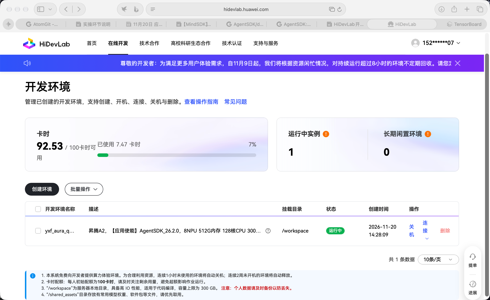
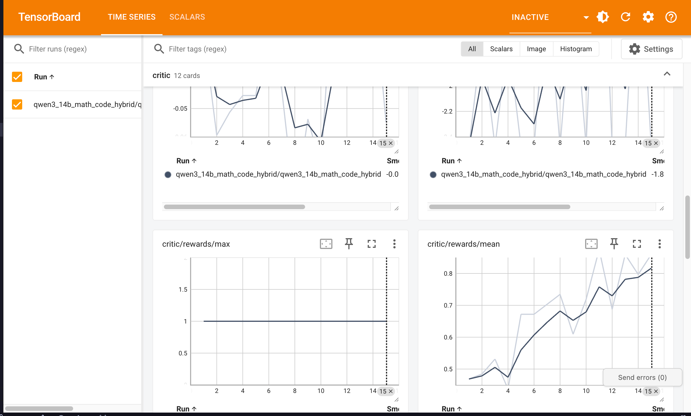
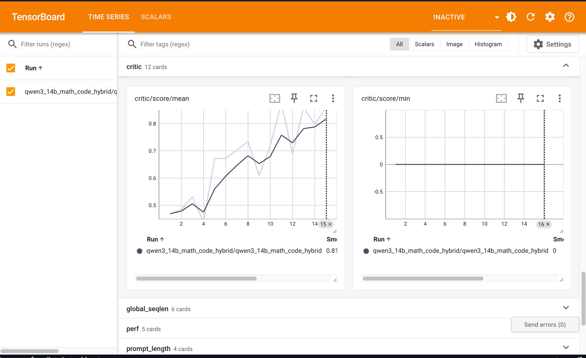
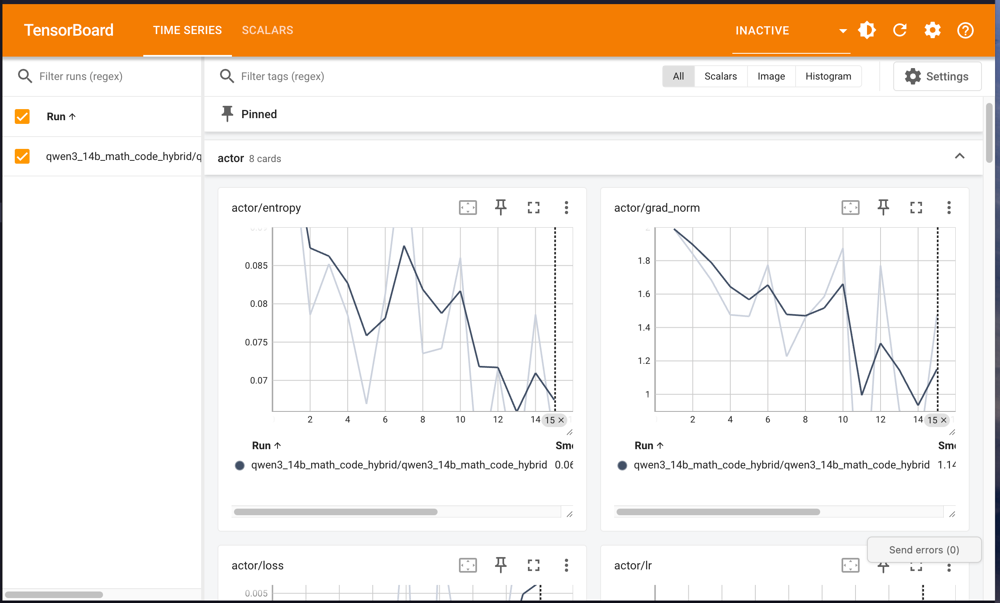

# 【MindSDK】基于 AgentSDK 完成 Qwen3-14B 共卡模式训推任务 总结报告

> **一句话结论**：目标达成，Qwen3-14B 在 Atlas 800I A2（8 × 64 GB）单机共卡模式（hybrid）下跑通 GRPO 训练，reward 从 0.469 提升到 0.859；关键阻塞点：**有** —— 快速入门文档的必改配置项与实际脚本行为不一致，首次启动失败 3 次；关键指标：**reward/mean 0.4688 → 0.8594**（gsm8k 规则判分准确率，口径为 8 prompt × 8 采样/步）、单步耗时 **125 s**、actor MFU **4.06%**、rollout 与训练引擎 logprob 比值 **1.0007**。

## 1 文档信息

| 项目 | 内容 |
| --- | --- |
| 文档类型 | 验证报告 / 活动实操总结 |
| 任务名称 | 【MindSDK】基于 AgentSDK 完成 Qwen3-14B 共卡模式训推任务 |
| 代码仓库 | <https://gitcode.com/Ascend/AgentSDK.git>（分支 `experimental`，目录 `experimental/`） |
| 提交人 | HiLab ID：`hush15250856307`；GitCode ID：`<待填写>` |
| 文档版本 / 日期 | v1 / 2026-11-20 |
| 验证环境 | 昇腾 A2（Atlas 800I A2）单机，8 × 910B3（64 GB HBM），512 GB 内存，128 核 |
| 镜像版本 | `agentsdk:26.2.0-cann9.0.0-torch_npu2.10.0-910b-ubuntu22.04-py3.11` |
| 代码基线 | AgentSDK commit `9c81ee42`（镜像内 `/home/work/AgentSDK`） |

## 2 任务背景与目标

- **任务目标**：在单机 8 卡 A2 平台上，严格按官方《Qwen3-14B 共卡模式快速入门指南》完成 Qwen3-14B + GSM8K 的共卡模式（hybrid）RL 训练，产出启动日志、运行中日志与 TensorBoard reward 曲线，并判断曲线是否符合预期。
- **任务结果**：**达成**。环境准备、模型/数据集获取、配置修改、训练启动、TensorBoard 观测全链路跑通；受算力时长预算限制，训练在 **step 15 / 200** 处主动停止，曲线趋势已稳定，满足验收判据。
- **关键阻塞点**：**有**，共 3 次启动失败，均源于文档配置说明与实际脚本行为不一致（详见第 4、5、7 章）。
- **关键指标**：

| 指标 | 数值 | 口径 |
| --- | --- | --- |
| reward/mean | 0.4688 → **0.8594** | step 1 → 15；每步 8 prompt × 8 采样 = 64 条轨迹的规则判分均值（对 1 / 错 0） |
| response_length/mean | 467.97 → **343.59** | 生成答案 token 数均值 |
| 单步耗时 | **125.15 s** | `perf/time_per_step`（step 15），全程 110~135 s |
| 生成 / 训练 / 权重同步 | 67.6 s / 39.2 s / 5.9 s | `timing_s/gen`、`timing_s/update_actor`、`timing_s/update_weights` |
| actor MFU | **4.06%** | `perf/mfu/actor`，共卡模式等待生成导致偏低，属预期 |
| rollout 与训练一致性 | ppl_ratio **1.0007**，pearson **0.9945** | `rollout_corr/ppl_ratio`、`training/rollout_actor_probs_pearson_corr` |
| 显存占用 | **46 GB / 64 GB per NPU** | `npu-smi info`，8 卡均布（actor + ref + vLLM 共卡） |
| 启动到首步耗时 | 约 **10 分钟** | 07:42:41 执行脚本 → 07:53 首个 step |
| 全量 200 步预计时长 | 约 **7 小时** | 125 s/步推演 |

## 3 环境准备

### 3.1 步骤 1：申请/创建算力环境

- 平台：HiDevLab「开发环境」
- 实例：「应用使能」AgentSDK_26.2.0 镜像，**昇腾 A2，8 NPU，512 GB 内存，128 核 CPU**，工作目录挂载 `/workspace`
- 卡时：已用 7.47 / 100 卡时
- 实测：`npu-smi info` 8 卡 `Health: OK`，空闲时约 3.4 GB HBM 为驱动/CANN 基线占用



### 3.2 步骤 2：镜像

```text
swr.cn-south-1.myhuaweicloud.com/ascendhub/agentsdk:26.2.0-cann9.0.0-torch_npu2.10.0-910b-ubuntu22.04-py3.11
```

> 该镜像已内置 CANN / torch_npu / verl / vLLM / rllm 及 `third_party` 依赖，无需额外安装。

### 3.3 步骤 3：容器内依赖版本核对（实测）

| 组件 | 版本 |
| --- | --- |
| OS | Ubuntu 22.04.5 LTS（aarch64） |
| Python | 3.11.15 |
| CANN | 9.0.0 |
| torch_npu | 2.10.0 |
| verl | 0.8.0.dev0（安装于 `/verl`） |
| vLLM | 0.22.1 |
| TensorBoard | 2.21.0 |
| npu-smi / driver | 26.1.1 |

> **注意**：可运行代码仓为镜像内 `/home/work/AgentSDK`。若另建了普通 git 克隆（如 `/workspace/AgentSDK`），其 `third_party/agent_engine/rllm` 为空，启动会报 `ModuleNotFoundError: No module named 'rllm'`，请勿混用。

### 3.4 步骤 4：模型获取

```shell
modelscope download --model Qwen/Qwen3-14B --local_dir /workspace/Qwen3-14B
```

实测：8 个 safetensors 分片，合计约 28.8 GB。

### 3.5 步骤 5：数据集获取与处理

```shell
modelscope download --dataset AI-ModelScope/gsm8k --local_dir /workspace/gsm8k

python3 gsm8k.py \
    --local_dataset_path /workspace/gsm8k \
    --local_save_dir /workspace/gsm8k-output
```

实测产物：`train.parquet` **7473** 条、`test.parquet` **1319** 条；字段 `data_source / prompt / ability / reward_model / extra_info`，其中 `reward_model.style=rule`、`ground_truth` 为答案数字，适配 GSM8K 规则判分。

## 4 配置文件修改

改动集中在 `/home/work/AgentSDK/aura/configs/`，共 4 个文件。

### 4.1 训练配置：`configs/train/verl_train_hybrid_A2_t8_qwen3_14b_math_fsdp.yaml`

```yaml
hydra:
  searchpath:
    - file:///verl/verl/trainer/config
    - file:///home/work/AgentSDK/aura/configs/train/verl_conf   # 必须三斜杠 file:///
verl_conf:
  data:
    train_files: /workspace/gsm8k-output/train.parquet
    val_files: /workspace/gsm8k-output/test.parquet
  actor_rollout_ref:
    model:
      path: /workspace/Qwen3-14B
```

> **踩坑 1**：按文档写成 `file:/home/work/...`（单斜杠）时，Hydra 1.3.7 告警 `provider=hydra.searchpath in main, path=file:/... is not available`，该路径被静默忽略，必须写成 `file:///`。

### 4.2 通讯配置：`configs/hosts.conf`

```text
# host,index,train_master_index,infer_master_index(可选)
179.47.53.137,0,1,1
```

- `host` 必须是本机 `DEFAULT_SOCKET_IFNAME` 对应网卡的 IP（本次 `ifconfig` 中 `eth0` = 179.47.53.137）
- 单机训推共部署，`train_master_index`、`infer_master_index` 均填 1
- **踩坑 2**：文件默认保留 `0.0.0.0,0,0` / `0.0.0.0,1,1` 示例行，若未清理且本机 IP 匹配不到，`VC_TASK_INDEX` 为空 → `NODE_TYPE: NULL`

### 4.3 基础配置：`configs/base.conf`

```ini
work_mode=hybrid
train_config_name=verl_train_hybrid_A2_t8_qwen3_14b_math_fsdp
#infer_config_name=vllm_infer_i16_qwen3_32b
```

- **踩坑 3（最致命）**：只改 `work_mode=hybrid` 而漏改 `train_config_name`，脚本会直接按 `verl_train_async_A3_t16_qwen3_32b_math_fsdp`（A3 16 卡 / 32B / 全异步模板）启动，与实际 8 卡 A2 完全不匹配，且无任何校验提示
- **踩坑 4**：`infer_config_name` 在共卡模式“不生效”，但脚本 `set_infer_visible_devices()` 在 hybrid 分支仍会读取 `configs/infer/${INFER_CONF_NAME}.yaml`，不注释会打印 `FileNotFoundError: .../configs/infer/.yaml`

### 4.4 环境变量：`configs/env/env.local`（需新建）

```ini
DEFAULT_SOCKET_IFNAME=eth0
ASCEND_RT_VISIBLE_DEVICES=0,1,2,3,4,5,6,7
```

- 该文件**默认不存在**，文档写“修改”实际需先新建
- 加载优先级：命令行 `export` > `env.local` > `env.conf`（`scripts/base/load_env.sh`）

## 5 启动与运行日志

### 5.1 启动命令

```shell
cd /home/work/AgentSDK/aura
export DEFAULT_SOCKET_IFNAME=eth0
export ASCEND_RT_VISIBLE_DEVICES=0,1,2,3,4,5,6,7
bash scripts/start_rl_with_verl_vllm.sh 2>&1 | tee train.log
```

### 5.2 启动日志片段

```text
[INFO] [ 26-11-20 07:42:41 ] VC_TASK_HOSTS: 179.47.53.137
[INFO] [ 26-11-20 07:42:41 ] VC_TASK_INDEX: 0
[INFO] [ 26-11-20 07:42:41 ] MASTER_TRAIN_INDEX: 0
[INFO] [ 26-11-20 07:42:41 ] MASTER_INFER_INDEX: 0
[INFO] [ 26-11-20 07:42:41 ] RL_TRAIN_BACKEND: verl
[INFO] [ 26-11-20 07:42:41 ] NODE_TYPE: hybrid
[INFO] [ 26-11-20 07:42:43 ] start verl train cluster, work_mode: hybrid, config name: verl_train_hybrid_A2_t8_qwen3_14b_math_fsdp
[train_cluster] 2026-11-20 07:42:55,103  SUCC scripts.py:1082 -- Ray runtime started.
[train_cluster] (vLLMHttpServer pid=88483) (Worker_TP0 pid=91878) INFO 11-20 07:51:14 [model_runner_v1.py:3633] Loading model weights took 6.9657 GB
[train_cluster] (vLLMHttpServer pid=88483) (Worker_TP1 pid=92561) INFO 11-20 07:51:14 [model_runner_v1.py:3633] Loading model weights took 6.9657 GB
[train_cluster] (vLLMHttpServer pid=88483) (Worker_TP2 pid=93073) INFO 11-20 07:51:14 [model_runner_v1.py:3633] Loading model weights took 6.9657 GB
[train_cluster] (vLLMHttpServer pid=88483) (Worker_TP3 pid=93695) INFO 11-20 07:51:14 [model_runner_v1.py:3633] Loading model weights took 6.9657 GB
[train_cluster] (HybridTaskRunner pid=83410) Training Progress:   0%|          | 1/934000 [00:00<?, ?it/s]
```

**启动阶段耗时分解（实测）**

| 阶段 | 时间点 | 现象 |
| --- | --- | --- |
| 脚本解析 + 节点判定 | 07:42:41 | `NODE_TYPE: hybrid` |
| Ray 集群就绪 | 07:42:55 | `Ray runtime started` |
| verl worker 拉起（Rank 0~7） | 约 07:48 | `npu-smi` 出现 `rayWorkerDict` |
| vLLM 权重加载（6.97 GB/worker） | 07:51:15 | HBM 12 GB/卡 |
| 首个 step | 约 07:53 | HBM 46 GB/卡，AICore 开始有占用 |

> 从执行脚本到第一个 step 约 **10 分钟**；前 5 分钟 `npu-smi info` 看不到任何 NPU 进程、日志也无进度输出，属正常启动阶段，很容易被误判为卡死。

### 5.3 运行中日志片段

```text
[train_cluster] (HybridTaskRunner pid=83410) step:15 - global_seqlen/min:9713 - global_seqlen/max:13806 \
  - global_seqlen/mean:11331.5 - actor/entropy:0.062161 - perf/mfu/actor_infer:0.048015 \
  - training/rollout_probs_diff_mean:0.003206 - training/rollout_actor_probs_pearson_corr:0.994501 \
  - rollout_corr/kl:0.000679 - rollout_corr/ppl_ratio:1.000738 - rollout_corr/chi2_token:0.001509
[train_cluster] (AgentExecutor pid=81499) 2026-11-20 08:09:02|INFO|agent_execution_engine.py|run_agent_trajectory_async():534|call tool step: 1 end ...
```

## 6 TensorBoard 与指标趋势

### 6.1 启动看板

```shell
tensorboard --logdir /home/work/AgentSDK/aura/tensorboard_log --port 6688 --host 0.0.0.0
```

- 事件目录：`tensorboard_log/<project_name>/<experiment_name>/events.out.tfevents.*`，本次为 `tensorboard_log/qwen3_14b_math_code_hybrid/qwen3_14b_math_code_hybrid/`
- 命令需带 `--host 0.0.0.0` 才能从容器外访问（文档原命令缺失）

### 6.2 reward 曲线（核心）



`critic/rewards/mean` 为每步 64 条轨迹的平均判分，等价于训练集准确率；`critic/rewards/max` 恒为 1，说明每步都有答对的样本。

| step | 1 | 2 | 3 | 4 | 5 | 6 | 7 | 8 |
| --- | --- | --- | --- | --- | --- | --- | --- | --- |
| reward/mean | 0.469 | 0.484 | 0.531 | 0.438 | 0.672 | 0.672 | 0.703 | 0.734 |

| step | 9 | 10 | 11 | 12 | 13 | 14 | 15 |
| --- | --- | --- | --- | --- | --- | --- | --- |
| reward/mean | 0.781 | 0.797 | 0.797 | 0.828 | 0.828 | 0.828 | **0.859** |

判读：整体单边上升，step 4 回落至 0.438 属 batch 内题目难度波动；15 步累计 +39 个百分点，`critic/score/mean` 同步到 0.81。



### 6.3 其他指标趋势



| 指标 | step 1 | step 15 | 判读 |
| --- | --- | --- | --- |
| `response_length/mean` | 467.97 | 343.59 | 回答变短，模型学会更直接给结论 |
| `actor/entropy` | 0.1018 | 0.0622 | 平缓下降，未出现多样性坍缩 |
| `actor/grad_norm` | 1.990 | 1.474 | 全程 1.2~2.0，无梯度爆炸/消失 |
| `actor/pg_clipfrac` | 0.0025 | 0.0021 | 被 clip 的 token 占比极小，更新幅度保守 |
| `actor/ppo_kl` | 0.0001 | 0.0004 | 每步策略偏移极小 |
| `rollout_corr/ppl_ratio` | 1.0003 | 1.0007 | ≈1，说明共卡模式权重同步链路正确 |
| `pearson_corr` | 0.9954 | 0.9945 | vLLM 与训练引擎输出概率高度一致 |
| `perf/time_per_step` | 134.7 s | 125.2 s | 约 2 分钟/步 |
| `perf/mfu/actor` | 5.76% | 4.06% | 共卡模式偏低属预期（约一半时间等生成） |

完整逐 step 数据见 `MindSDK-hush15250856307-metrics.csv`（14 项指标 × 15 步，可直接绘图）。

### 6.4 是否符合预期

满足以下全部判据，判定**符合预期**：

1. reward 单调上升、无 NaN/Inf，15 步内 +39 个百分点；
2. `grad_norm` 稳定在 1.2~2.0，`pg_clipfrac`≈0.2%、`ppo_kl`<0.001，无策略崩溃风险；
3. `entropy` 平缓下降（0.102→0.062），未出现多样性坍缩；
4. `rollout_corr/ppl_ratio≈1`、`pearson_corr≈0.995`，共卡模式权重同步正确；
5. `response_length/clip_ratio` 仅 0.0156，未被 `max_response_length=16384` 截断影响。

## 7 发现的问题与优化建议

| # | 问题 | 影响 | 建议 |
| --- | --- | --- | --- |
| 1 | `base.conf` 的 `train_config_name` 与 `work_mode` 不联动、无校验 | 漏改即加载 32B / A3 / async 模板，启动中途才失败 | 启动脚本增加校验：hybrid 模式要求配置名含 `hybrid`，且 yaml 中 `n_gpus_per_node` 与实际卡数一致，不一致直接报错退出 |
| 2 | hybrid 分支仍调用 `set_infer_visible_devices()` 读取空 `INFER_CONF_NAME` | 打印 `FileNotFoundError: configs/infer/.yaml`，并把 `ASCEND_RT_VISIBLE_DEVICES` 置空，误导排查 | hybrid 分支跳过该函数；缺文件时 WARN 而非抛异常 |
| 3 | 文档 `hydra.searchpath` 写成 `file:/...` 单斜杠 | Hydra 静默忽略该路径，仅告警 | 文档与 yaml 注释统一为 `file:///...` |
| 4 | `configs/env/env.local` 默认不存在，文档要求“修改” | 用户改 `env.conf`，重开 shell 后配置丢失 | 提供 `env.local.example`，或文档写明需新建 |
| 5 | `hosts.conf` 保留 `0.0.0.0` 示例行 | 本机 IP 匹配不到时 `VC_TASK_INDEX` 为空、`NODE_TYPE: NULL`，报错不直观 | 匹配失败时显式提示检查 `DEFAULT_SOCKET_IFNAME` 与 `hosts.conf` |
| 6 | TensorBoard 命令缺 `--host 0.0.0.0` | 容器外打不开看板 | 文档补充该参数与事件目录层级说明 |
| 7 | 文档未给时间预期 | 易误判卡死、误以为几分钟就能出曲线 | 补充耗时预期：启动到首步约 10 min、单步约 2 min、200 步约 7 h |

## 8 交付件清单

| # | 交付件 | 状态 |
| --- | --- | --- |
| 1 | `MindSDK-hush15250856307-Qwen3-14B共卡模式训练总结报告.md` | 本文件 |
| 2 | `MindSDK-hush15250856307-metrics.csv` | 已生成（15 步 × 14 指标） |
| 3 | `docker_images.png` | 已提供（开发环境实例） |
| 4 | `tensorboard_1.png` | 已提供（reward 曲线） |
| 5 | `tensorboard_2.png` | 已提供（score / global_seqlen） |
| 6 | `tensorboard_3.png` | 已提供（entropy / grad_norm） |
| 7 | 启动日志 / 运行日志文件 | 待归档（正文第 5 章已内嵌关键片段） |

## 9 结论与后续

1. **共卡模式可用**：单机 8 卡 A2 + 14B 模型 + GSM8K，从执行脚本到出曲线约 20 分钟，reward 形态健康，可作为基线复现。
2. **主要改进点在文档与脚本健壮性**：7 处问题中有 5 处表现为“配置写错但不报错”，建议优先落地第 7 章 #1、#2。
3. **后续计划**：跑满 `total_train_steps=200`（约 7 小时）观察 reward 是否在 0.9 附近进入平台期；`save_freq=100` 产出 ckpt 后补一次验证（当前 `test_freq=1000`，建议改为 50 以观测泛化）。

---

## 附录 A：本报告的提交流程

> 目标位置：分支 `experimental` 下的 `experimental/` 目录。

```shell
# 1. 在 GitCode 页面 Fork 仓库：https://gitcode.com/Ascend/AgentSDK.git
git clone https://gitcode.com/<你的GitCodeID>/AgentSDK.git
cd AgentSDK

# 2. 基于上游 experimental 分支拉开发分支
git remote add upstream https://gitcode.com/Ascend/AgentSDK.git
git fetch upstream
git checkout -b meetup-qwen3-14b-hybrid-report upstream/experimental

# 3. 放置交付件
mkdir -p experimental
cp /workspace/code/MindSDK-hush15250856307-* \
   /workspace/code/docker_images.png \
   /workspace/code/tensorboard_1.png \
   /workspace/code/tensorboard_2.png \
   /workspace/code/tensorboard_3.png \
   experimental/

# 4. 提交并推送
git add experimental/
git commit -m "【MindSDK】基于AgentSDK完成Qwen3-14B共卡模式训推任务 总结报告"
git push origin meetup-qwen3-14b-hybrid-report
```

- 发起 PR：源分支 `<你的GitCodeID>:meetup-qwen3-14b-hybrid-report` → 目标 `Ascend/AgentSDK:experimental`
- PR 标题：`【MeetUp】<任务名称> 总结报告`
- CLA：本 PR 已通过机器人检查（`ascend-robot`：**CLA Signature Pass**）；未签署者可在此补签 <https://clasign.osinfra.cn/sign/gitee_ascend-1611222220829317930>
- 评审：按仓库机器人配置，`repo-Ascend/AgentSDK` 模块需 **≥ 3 人 `/lgtm`** 与 **≥ 1 人 `/approve`**，且不可自行合入
